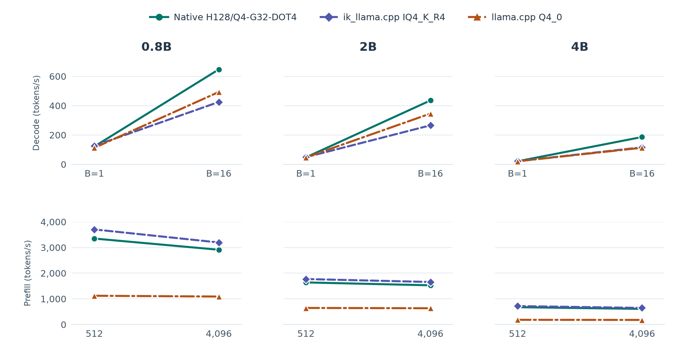

# Qwen3.5 CPU

Run Qwen3.5 text models locally on an x86 CPU. The engine ships as a native
HTTP server and a raw text-completion CLI, and can be embedded in a C++20
application. The ready-to-run **0.8B** checkpoint uses **425 MB of weights**.
Source builds also run **2B** and **4B** text models. The engine selects AVX2
or AVX-512 kernels at runtime on supported CPUs.

[Quick start](#download-and-run) · [CPU benchmarks](#cpu-performance) · [Documentation](docs/README.md)

## What you can run

- **Local chat and tools.** Connect a chat client through OpenAI-compatible Chat Completions or Anthropic Messages for streaming text, constrained JSON and tool calls. Current source also supports OpenAI Responses and offline JSONL batches. [API and supported fields](docs/server.md)
- **Concurrent requests.** The C++ engine batches decode across active requests. Exact-prefix caching reuses work when requests share a system prompt or conversation history. [Embedding and scheduling](docs/cpu-engine-api.md)
- **Larger models and fine-tunes.** Pack 2B or 4B text weights in H128/Q4-G32-DOT4 format. The 4B profile supports optional multi-token prediction (MTP) for speculative decoding. Fine-tunes can expose classification or decision endpoints. [Packing guide](docs/quantization.md) · [4B agent benchmarks](docs/benchmarks/qwen35-4b-pi-agent.md) · [Fine-tune guide](docs/finetunes.md)
- **Browser decisions.** Try the separate qev-0.8b fine-tune running on your own CPU via WebAssembly. [Live playground](https://huggingface.co/spaces/danmoreng/qev-0.8b-cpu-playground)

## Download and run

Download and extract the [Windows x64 or Linux x64 release](https://github.com/Danmoreng/qwen35-cpu/releases).
From the extracted directory, fetch the pinned [0.8B model](https://huggingface.co/danmoreng/Qwen3.5-0.8B-H128-Q4-G32-DOT4)
and start the server. The downloader verifies each file. Linux binaries require
glibc 2.35 or newer.

**Linux**

```sh
bash ./download-model.sh danmoreng/Qwen3.5-0.8B-H128-Q4-G32-DOT4 f6cb5cf04a9094670f9041578a3f4e44b94a1395
./qwen35_cpu_server --model-dir models/qwen3.5-0.8b --threads 8
```

Send a chat request from a second terminal.

```sh
curl http://127.0.0.1:8080/v1/chat/completions -H 'Content-Type: application/json' \
  -d '{"messages":[{"role":"user","content":"Name three planets."}],"max_tokens":32,"temperature":0}'
```

<details>
<summary>Windows PowerShell commands</summary>

```powershell
./download-model.ps1 -Repo danmoreng/Qwen3.5-0.8B-H128-Q4-G32-DOT4 -Revision f6cb5cf04a9094670f9041578a3f4e44b94a1395
./qwen35_cpu_server.exe --model-dir models/qwen3.5-0.8b --threads 8
```

Send a chat request from a second PowerShell window.

```powershell
Invoke-RestMethod http://127.0.0.1:8080/v1/chat/completions -Method Post -ContentType application/json -Body '{"messages":[{"role":"user","content":"Name three planets."}],"max_tokens":32,"temperature":0}'
```

</details>

<a id="qwen35-08b-performance"></a>

## CPU performance

Measured November 20, 2026 on the **AMD Ryzen 9 9955HX3D** laptop with eight threads pinned to
physical cores 0–7. Rates are median **tokens/s** from three runs after one
warmup. Prefill measures one prompt. Decode uses 512 input and 128 output
tokens per request. B=16 is total throughput across 16 private requests.



| Model | Engine / checkpoint | Tensor MB | Decode B=1 | Decode B=16 | Prefill 512 | Prefill 4,096 |
| --- | --- | ---: | ---: | ---: | ---: | ---: |
| 0.8B | ik_llama.cpp IQ4_KS_R4 | 401.4 | 134.2 | 440.1 | 3,715.4 | 3,214.2 |
| 0.8B | ik_llama.cpp IQ4_K_R4 | 424.9 | 126.2 | 425.1 | 3,703.7 | 3,195.1 |
| 0.8B | **Native H128/Q4-G32-DOT4** | 424.9 | 121.5 | 647.2 | 3,348.4 | 2,912.2 |
| 0.8B | llama.cpp Q4_0 | 424.9 | 112.5 | 493.1 | 1,119.6 | 1,089.0 |
| 0.8B | llama.cpp Unsloth Q4_K_M | 521.6 | 90.8 | 429.3 | 1,025.0 | 1,103.0 |
| 2B | ik_llama.cpp IQ4_K_R4 | 1,060.4 | 48.9 | 265.9 | 1,771.2 | 1,656.1 |
| 2B | **Native H128/Q4-G32-DOT4** | 1,060.4 | 47.5 | 435.5 | 1,639.0 | 1,526.9 |
| 2B | llama.cpp Q4_0 | 1,060.4 | 47.0 | 345.9 | 644.9 | 633.1 |
| 4B | ik_llama.cpp IQ4_K_R4 | 2,369.0 | 21.2 | 115.9 | 717.1 | 645.8 |
| 4B | **Native H128/Q4-G32-DOT4** | 2,369.0 | 20.8 | 186.2 | 674.4 | 608.2 |
| 4B | llama.cpp Q4_0 | 2,369.0 | 20.4 | 112.9 | 182.5 | 178.1 |

Native had the highest batch-16 decode throughput at all three model sizes. The three charted formats have the same tensor size within each model size. [Throughput measurements](docs/benchmarks/laptop-refresh-9955hx3d.md#base-model-throughput)

For native qev-0.8b decisions, median HTTP latency was **40.29 ms** (74 input tokens) and **180.07 ms** (579 input tokens), both 7.6% lower than before the prefill changes. [Decision benchmark](docs/benchmarks/laptop-refresh-9955hx3d.md#qev-08b-decision-latency) · [Short-ticket and concurrency tuning](docs/benchmarks/decision-tuning-9955hx3d.md)

<a id="quantization-quality"></a>

### 0.8B quantization quality

Perplexity (PPL) measures how well the model predicts the reference text.
KL measures how closely its predictions match the BF16 teacher, in nats.
Lower is better for both. Scores cover 8,192 tokens from 16 English WikiText-2
test windows. MB measures the on-disk tensor payload.

| Scoring engine / checkpoint | Tensor MB | PPL ↓ | KL to BF16 ↓ |
| --- | ---: | ---: | ---: |
| llama.cpp BF16 reference | 1,505.8 | 14.38556 | 0 |
| llama.cpp Unsloth Q4_K_M | 521.6 | 14.77209 | 0.034894 |
| ik_llama.cpp IQ4_K_R4 | 424.9 | 15.77716 | 0.068812 |
| **Native H128/Q4-G32-DOT4** | 424.9 | 15.79649 | 0.060100 |
| llama.cpp Q4_0 | 424.9 | 18.03403 | 0.144830 |
| ik_llama.cpp IQ4_KS_R4 | 401.4 | 15.86784 | 0.084944 |

The November 19 native build reproduced every vocabulary logit from the October
quality run. The comparator scores come from that run with the same binaries
and weights. [Native verification](docs/results/readme-2026-11-19/native-quality.json) · [Quality measurements](docs/benchmarks/cpu.md#quality-and-size)

## Build from source

Use a C++20 compiler, CMake 3.24+ and Ninja. On Linux, run the following from
the repository root.

```sh
cmake -S . -B build -G Ninja -DCMAKE_BUILD_TYPE=Release
cmake --build build
ctest --test-dir build --output-on-failure
```

On Windows, run `./scripts/build.ps1` with Visual Studio 2022 C++ Build Tools
and PowerShell 7. For an engine and CLI build, set `-DQWEN35_BUILD_SERVER=OFF`
when configuring CMake. The engine is MIT-licensed. Model weights are distributed
separately under their own licenses.

[Documentation](docs/README.md) · [Model formats and calibration](docs/quantization.md) ·
[0.8B GGUF support](docs/q4km-native.md) · [Validation](docs/validation.md) · [Provenance](PROVENANCE.md)
