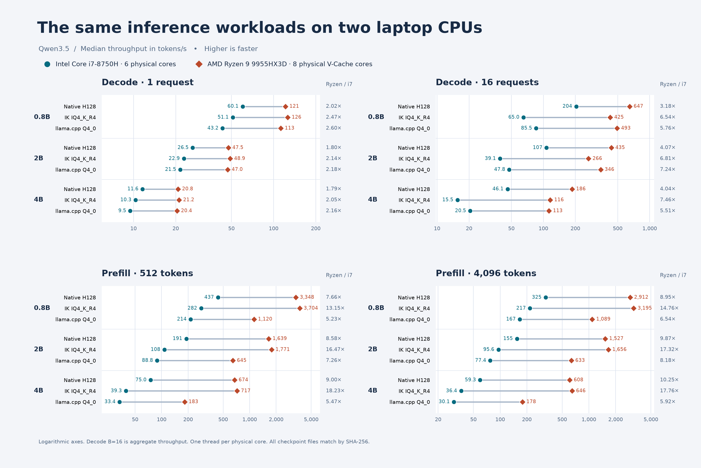

# Core i7-8750H vs Ryzen 9 9955HX3D for Qwen3.5

The Intel laptop repeated every throughput workload behind the README's
Ryzen report using six threads on six physical cores. The Ryzen reference
uses eight threads on eight physical cores of its V-Cache CCD. Both sets use
the same engine revisions, fixed prompt and continuation IDs, and all 11
original throughput checkpoints. The Ryzen measurements are from November 20,
2026, and the i7 measurements are from November 21, 2026.
[Ryzen report](laptop-refresh-9955hx3d.md)



## Native engine speed ratios

Ratios are Ryzen throughput divided by i7 throughput. Decode B=16 measures
total throughput across the 16 requests.

| Qwen3.5 | Decode B=1 | Decode B=16 | Prefill 512 | Prefill 4,096 |
| --- | ---: | ---: | ---: | ---: |
| 0.8B | 2.02× | 3.18× | 7.66× | 8.95× |
| 2B | 1.80× | 4.07× | 8.58× | 9.87× |
| 4B | 1.79× | 4.04× | 9.00× | 10.25× |

The native engine led the i7 results at all model sizes for both decode
modes and both prefill lengths. On the Ryzen, native led batch-16 decode
and ik_llama.cpp led single-request decode and prefill.

## Throughput by engine and checkpoint

Speed cells show **i7 / Ryzen** in median tokens/s. The chart shows the
three equal-size tensor payloads at each model size. The table also includes
the two additional 0.8B comparators.

| Model | Engine / checkpoint | Tensor MB | Decode B=1 | Decode B=16 | Prefill 512 | Prefill 4,096 |
| --- | --- | ---: | ---: | ---: | ---: | ---: |
| 0.8B | Native H128/Q4-G32-DOT4 | 424.9 | 60.1 / 121.5 | 203.7 / 647.2 | 437.1 / 3,348.4 | 325.2 / 2,912.2 |
| 0.8B | ik_llama.cpp IQ4_KS_R4 | 404.0 | 53.1 / 134.2 | 63.6 / 440.1 | 283.9 / 3,715.4 | 218.3 / 3,214.2 |
| 0.8B | ik_llama.cpp IQ4_K_R4 | 424.9 | 51.1 / 126.2 | 65.0 / 425.1 | 281.6 / 3,703.7 | 216.5 / 3,195.1 |
| 0.8B | llama.cpp Q4_0 | 424.9 | 43.2 / 112.5 | 85.5 / 493.1 | 213.9 / 1,119.6 | 166.5 / 1,089.0 |
| 0.8B | llama.cpp Unsloth Q4_K_M | 521.6 | 37.2 / 90.8 | 81.6 / 429.3 | 234.9 / 1,025.0 | 181.8 / 1,103.0 |
| 2B | Native H128/Q4-G32-DOT4 | 1,060.4 | 26.5 / 47.5 | 107.0 / 435.5 | 191.0 / 1,639.0 | 154.7 / 1,526.9 |
| 2B | ik_llama.cpp IQ4_K_R4 | 1,060.4 | 22.9 / 48.9 | 39.1 / 265.9 | 107.5 / 1,771.2 | 95.6 / 1,656.1 |
| 2B | llama.cpp Q4_0 | 1,060.4 | 21.5 / 47.0 | 47.8 / 345.9 | 88.8 / 644.9 | 77.4 / 633.1 |
| 4B | Native H128/Q4-G32-DOT4 | 2,369.0 | 11.6 / 20.8 | 46.1 / 186.2 | 75.0 / 674.4 | 59.3 / 608.2 |
| 4B | ik_llama.cpp IQ4_K_R4 | 2,369.0 | 10.3 / 21.2 | 15.5 / 115.9 | 39.3 / 717.1 | 36.4 / 645.8 |
| 4B | llama.cpp Q4_0 | 2,369.0 | 9.5 / 20.4 | 20.5 / 112.9 | 33.4 / 182.5 | 30.1 / 178.1 |

All 11 throughput files match the Ryzen SHA-256 values. The common
0.8B IQ4_KS_R4 GGUF file is 414,992,672 bytes on disk. Its tensor payload sums to
404,030,976 bytes using the pinned ik_llama.cpp GGUF reader.
The Ryzen reference table listed 401,437,952 tensor bytes.
The table above uses the measured payload for the shared file.

[Medians and ranges](../results/i7-ryzen-comparison-2026-11-21/throughput.csv) · [Individual samples](../results/i7-ryzen-comparison-2026-11-21/samples.csv) · [Commands and SHA-256 manifest](../results/i7-ryzen-comparison-2026-11-21/manifest.json)

## qev-0.8b HTTP latency

The first two workloads time the first request after a fresh server is ready.
The German routing panel sends 64 distinct requests serially to one resident
server. The table uses the final native core and the median of three per-run
HTTP p50 and p95 timings.

| Workload | Input tokens | i7 p50 | Ryzen p50 | i7 p95 | Ryzen p95 | i7 / Ryzen p50 |
| --- | ---: | ---: | ---: | ---: | ---: | ---: |
| First short ticket | 74 | 218.40 ms | 40.29 ms | 218.40 ms | 40.29 ms | 5.42× |
| First long ticket | 579 | 1,359.79 ms | 180.07 ms | 1,359.79 ms | 180.07 ms | 7.55× |
| German routing panel | 178–216 | 504.92 ms | 57.50 ms | 555.97 ms | 62.86 ms | 8.78× |

Median HTTP p50 changed as follows from the baseline to the final native core.

| Workload | i7 p50 change | Ryzen p50 change |
| --- | ---: | ---: |
| First short ticket | +3.05% | -7.59% |
| First long ticket | -0.43% | -7.59% |
| German routing panel | +0.13% | -8.85% |

The two hosts agreed on 65 of 66 selections across all three core revisions
and measured runs, for 585 of 594 matching pairs. Token usage matched in
all 594 pairs. Each returned probability vector differed by more than
the absolute tolerance of 0.000001 in at least one entry. The largest
absolute difference was 2.14 percentage points.
All requests generated zero tokens and read zero cached tokens. The separately
calibrated qev model and its package files matched the Ryzen hashes.
For routing input `2d933707a9`, the i7 chose B
(31.84%) and the Ryzen chose A (32.81%).
The choices were stable across repetitions and core revisions on each host.

[Per-run p50 and p95](../results/i7-ryzen-comparison-2026-11-21/decision-samples.csv) · [Decision summary](../results/i7-ryzen-comparison-2026-11-21/decisions.csv) · [Per-input equivalence](../results/i7-ryzen-comparison-2026-11-21/decision-parity.csv) · [Ryzen profile hashes and parity summary](../results/i7-ryzen-comparison-2026-11-21/decision-parity.json)

## Setup and reproduction

| Setting | Core i7-8750H | Ryzen 9 9955HX3D |
| --- | --- | --- |
| Inference threads and affinity | 6 physical cores, CPUs 0–5, mask `0x3f` | 8 physical V-Cache cores, CPUs 0–7, mask `0xff` |
| Native SIMD dispatch | AVX2/FMA/F16C | AVX-512/VNNI |
| L3 available to selected cores | 9 MiB | 96 MiB |
| Build compiler | GCC 15.2.0 | GCC 16.2.1 |
| Linux kernel | 7.0.0-43-generic | 7.3.4-arch1-2 |
| AC power settings | Intel P-state, powersave, balance_power, turbo on, max_perf_pct=80, package limits 30 W / 38 W | AMD P-state EPP, powersave, balance_performance, max-power platform profile |

Both laptops used CPU-native Release builds of native `a3e9935`, llama.cpp
`7170cad`, and ik_llama.cpp `98aca86`. The latter used runtime repacking
and the recorded graph-capacity fix for batch 16. Native decision latency
varied only the linked core. Intel's AC power settings were the same for
all engines and matched the earlier six-core AVX2 kernel measurements.

The sequential runner used one warmup and three measured runs per case
and reversed case order on alternate passes. The 512-token workload forces
128 output IDs and times 127 decode forwards for each request. The
4,096-token workload forces two output IDs. Throughput uses FP16 KV and
full-vocabulary readout. Prefill uses the native model-forward timer or
the comparator's synchronized prompt call. Throughput omits model loading,
tokenization, and HTTP. HTTP latency includes local transport and tokenization.

The i7 package peaked at 66 °C. The recorded thermal-throttling counters
stayed constant. A 137 ms firmware metadata refresh overlapped one scored
2B llama.cpp batch-16 run. Decode throughput varied by 0.05% across its
three measured runs.

Extract `.phase_metadata.speed.matrix` or `.phase_metadata.decision.matrix`
from the manifest and resolve the local inputs and executable paths. Run
from the pinned native source checkout.

```bash
OMP_NUM_THREADS=6 taskset -c 0-5 pwsh -NoProfile -File scripts/benchmark-inference-seq.ps1 \
  -Matrix "$matrix" -OutputDir "$output" -WarmupRuns 1 -Runs 3 -Affinity 63
```
