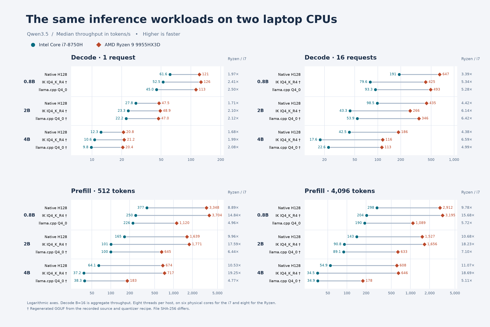

# Core i7-8750H vs Ryzen 9 9955HX3D for Qwen3.5

The Intel laptop repeated all 33 throughput workloads behind the README's
Ryzen chart and table. The comparisons use the same engine revisions,
fixed prompt and continuation tokens, and eight inference threads per
laptop. The qev HTTP latency tests use the same request fixtures and server
shell. The retained Ryzen measurements were collected on November 20, 2026.
[Ryzen report](laptop-refresh-9955hx3d.md)



## Native engine speed ratios

A ratio above 1 means higher throughput on the Ryzen. For batch 16,
the rate measures total decode throughput across all requests.

| Qwen3.5 | Decode B=1 | Decode B=16 | Prefill 512 | Prefill 4,096 |
| --- | ---: | ---: | ---: | ---: |
| 0.8B | 1.97× | 3.39× | 8.89× | 9.78× |
| 2B | 1.71× | 4.42× | 9.96× | 10.68× |
| 4B | 1.68× | 4.38× | 10.53× | 11.07× |

The native engine led on the i7 at every model size for both decode modes
and both prefill lengths. On the Ryzen, native led batch-16 decode and
ik_llama.cpp led single-request decode and prefill.

## Throughput by engine and checkpoint

Cells show **i7 / Ryzen**, in median tokens/s. The chart displays the
three equal-size tensor payloads at each model size. This table includes
both additional 0.8B comparators.

| Model | Engine / checkpoint | Tensor MB i7 / Ryzen | Decode B=1 | Decode B=16 | Prefill 512 | Prefill 4,096 |
| --- | --- | ---: | ---: | ---: | ---: | ---: |
| 0.8B | Native H128/Q4-G32-DOT4 | 424.9 / 424.9 | 61.6 / 121.5 | 190.8 / 647.2 | 376.7 / 3,348.4 | 297.7 / 2,912.2 |
| 0.8B | ik_llama.cpp IQ4_KS_R4 † | 404.0 / 401.4 | 54.8 / 134.2 | 77.3 / 440.1 | 250.6 / 3,715.4 | 205.4 / 3,214.2 |
| 0.8B | ik_llama.cpp IQ4_K_R4 † | 424.9 / 424.9 | 52.5 / 126.2 | 79.6 / 425.1 | 249.6 / 3,703.7 | 203.8 / 3,195.1 |
| 0.8B | llama.cpp Q4_0 | 424.9 / 424.9 | 45.0 / 112.5 | 93.3 / 493.1 | 225.7 / 1,119.6 | 190.4 / 1,089.0 |
| 0.8B | llama.cpp Unsloth Q4_K_M | 521.6 / 521.6 | 39.0 / 90.8 | 86.4 / 429.3 | 231.9 / 1,025.0 | 196.1 / 1,103.0 |
| 2B | Native H128/Q4-G32-DOT4 | 1,060.4 / 1,060.4 | 27.8 / 47.5 | 98.5 / 435.5 | 164.6 / 1,639.0 | 142.9 / 1,526.9 |
| 2B | ik_llama.cpp IQ4_K_R4 † | 1,060.4 / 1,060.4 | 23.3 / 48.9 | 43.3 / 265.9 | 100.7 / 1,771.2 | 90.8 / 1,656.1 |
| 2B | llama.cpp Q4_0 † | 1,060.4 / 1,060.4 | 22.2 / 47.0 | 53.9 / 345.9 | 100.2 / 644.9 | 89.1 / 633.1 |
| 4B | Native H128/Q4-G32-DOT4 | 2,369.0 / 2,369.0 | 12.3 / 20.8 | 42.5 / 186.2 | 64.1 / 674.4 | 54.9 / 608.2 |
| 4B | ik_llama.cpp IQ4_K_R4 † | 2,369.0 / 2,369.0 | 10.6 / 21.2 | 17.6 / 115.9 | 37.2 / 717.1 | 34.5 / 645.8 |
| 4B | llama.cpp Q4_0 † | 2,369.0 / 2,369.0 | 9.8 / 20.4 | 22.6 / 112.9 | 38.3 / 182.5 | 34.9 / 178.1 |

**Checkpoint identity.** 5 of 11 weight files are byte-identical
to the Ryzen reference.
Rows marked † use the recorded source weights and quantizer recipes.
The regenerated files have different SHA-256 hashes. The 0.8B IQ4_KS_R4
tensor payload measures 404.0 MB on the i7 and was reported as 401.4 MB
on the Ryzen. All nine charted rows match the reported tensor sizes.

[Medians, ranges and ratios](../results/i7-ryzen-comparison-2026-11-20/throughput.csv) · [Individual throughput samples](../results/i7-ryzen-comparison-2026-11-20/samples.csv) · [SHA-256 and command manifest](../results/i7-ryzen-comparison-2026-11-20/manifest.json)

## qev-0.8b HTTP latency

These rows use the native core version in the README latency result.
The two tickets each time the first request after a fresh server is
ready. The German routing panel times 64 serial requests on a resident
server. Each cell is the median of three per-run p50 or p95 values.

| Workload | Input tokens | i7 p50 | Ryzen p50 | i7 p95 | Ryzen p95 | i7 / Ryzen p50 |
| --- | ---: | ---: | ---: | ---: | ---: | ---: |
| First short ticket | 74 | 230.96 ms | 40.29 ms | 230.96 ms | 40.29 ms | 5.73× |
| First long ticket | 579 | 1571.12 ms | 180.07 ms | 1571.12 ms | 180.07 ms | 8.72× |
| German routing panel | 178–216 | 543.93 ms | 57.50 ms | 585.91 ms | 62.86 ms | 9.46× |

On the i7, the change from the baseline native core to the final one was +0.16% for the short ticket and -0.11% for the long ticket. The corresponding Ryzen latencies fell 7.6%. [Ryzen decision measurements](laptop-refresh-9955hx3d.md#qev-08b-decision-latency)

The decision CSV includes the baseline and intermediate core measurements.
All runs returned zero output tokens and used zero cached tokens.
The i7 server builds returned identical choices, probabilities and token usage
across repeats and core versions.
[Full decision comparison](../results/i7-ryzen-comparison-2026-11-20/decisions.csv) · [Individual decision samples](../results/i7-ryzen-comparison-2026-11-20/decision-samples.csv)

## Setup and timing

| Setting | Core i7-8750H | Ryzen 9 9955HX3D |
| --- | --- | --- |
| Inference threads and affinity | 8 on CPUs 0–7, including two SMT siblings | 8 on physical cores 0–7 of the V-Cache CCD |
| Physical cores in the mask | 6 | 8 |
| Native SIMD dispatch | AVX2/FMA/F16C | AVX-512/VNNI |
| Shared L3 for the selected cores | 9 MiB | 96 MiB |
| Build compiler | GCC 15.2.0 | GCC 16.2.1 |
| Linux kernel | 7.0.0-43-generic | 7.3.4-arch1-2 |
| Power settings | AC, intel_pstate powersave, balance_power, max_perf_pct 80 | AC, max-power, amd-pstate-epp, balance_performance |

The rates describe the two laptops under their recorded settings. Both
used CPU-native Release builds from the pinned sources. Native uses
`a3e9935`, llama.cpp `7170cad` and ik_llama.cpp `98aca86`.
IK uses runtime repacking and the recorded graph-capacity correction for
batch 16. The i7 links the patched IK translation unit against the same
unaffected objects as the unpatched build.

Every workload ran sequentially with one warmup and three measured runs.
The runner reversed case order on alternate passes. The 512-token workload
forces 128 output IDs and counts 127 decode forwards per request. The
4,096-token workload forces two output IDs and supplies the long-prefill
metric. The main table excludes model loading, tokenization and HTTP.
Prefill uses the native model-forward timer or the comparator's synchronized
prompt call. The README's PPL/KL table belongs to a separate quantization
quality evaluation.

The i7 package reached 71 °C during the throughput series.
The recorded hardware thermal-throttling counters stayed constant. A
scheduled host checkpoint overlapped only the warmup.

Rebuild the recorded revisions in Release mode. Extract `.phases.speed.matrix`
for throughput or `.decision_phase.matrix` for HTTP latency from the manifest.
Resolve the executable and input paths in the selected matrix to absolute
paths, then run from the matching source checkout.

```bash
OMP_NUM_THREADS=8 taskset -c 0-7 pwsh -NoProfile -File scripts/benchmark-inference-seq.ps1 \
  -Matrix "$matrix" -OutputDir "$output" -WarmupRuns 1 -Runs 3 -Affinity 255
```
