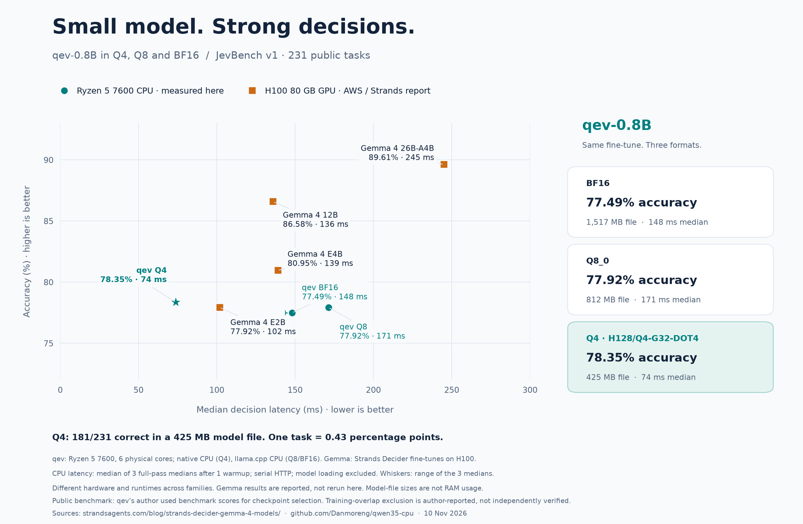

# qev on JevBench v1

On November 10, 2026, the published **425 MB qev-0.8b H128/Q4-G32-DOT4**
checkpoint scored **181/231 (78.35%)** on the same public tasks used in the
[Strands Decider Gemma 4 article](https://strandsagents.com/blog/strands-decider-gemma-4-models/).
All 231 responses passed strict distribution validation; there were no failed
requests, exclusions, truncated inputs or renormalized distributions.

## Comparison

The qev row is a new native CPU measurement. The Gemma rows are the **Strands
Decider fine-tunes**, copied from their published release results; they were
not rerun locally. Accuracy is the number of correct top-label decisions divided
by 231, including any invalid/failed responses as incorrect. Brier is the
upstream multiclass sum-of-squares score; lower is better.

| Model | Correct / 231 | Accuracy | Brier |
| --- | ---: | ---: | ---: |
| **qev-0.8b, H128/Q4-G32-DOT4 / native CPU** | **181** | **78.35%** | **0.329** |
| Strands Decider / Gemma 4 E2B | 180 | 77.92% | 0.313 |
| Strands Decider / Gemma 4 E4B | 187 | 80.95% | 0.243 |
| Strands Decider / Gemma 4 12B | 200 | 86.58% | 0.173 |
| Strands Decider / Gemma 4 26B-A4B | 207 | 89.61% | 0.162 |

Published baselines: [frozen release results](https://github.com/strands-labs/strands-decider/blob/0ac22a97e584f3ccf87cc9b8cc5fdbad57cdf534/evaluation/results.md#gemma-4-v1).

qev is one correct task / **0.43 percentage points above E2B**, six tasks /
2.60 points below E4B, 19 tasks / 8.23 points below 12B, and 26 tasks /
11.26 points below 26B-A4B. The E2B result is practically tied on this small
set; one extra correct item does not establish a general advantage. qev's
95% Wilson interval is **72.60–83.18%**, describing finite-task sampling only.
The public tasks are related and the interval is not a model-ranking test.
qev's Brier score is worse than all four published Gemma values, despite its
similar top-label accuracy to E2B. Its top-label ECE is **0.06750**.

This is the 231-task **public accuracy**, not the newer JevBench leaderboard
composite, sealed held-out score, or the separate Jev Skills suite. Different
model families, training recipes and numeric formats are being compared. This
run did not initially audit training or checkpoint selection. The subsequent
[precision and provenance audit](#precision-and-training-provenance-audit)
finds that the qev author used benchmark scores for checkpoint selection.
Training-overlap exclusion remains an author claim, not an independent finding.

## Published AWS model precision and artifact sizes

The four published Strands/Gemma configurations set `torch_dtype` to
`bfloat16`. The [serving loader](https://github.com/strands-labs/strands-decider/blob/0ac22a97e584f3ccf87cc9b8cc5fdbad57cdf534/src/strands_decider/modeling.py)
passes that dtype to the base-model loader, without Q4/Q8 quantization. The
base Hub metadata also reports BF16 tensors. Independently reading the small
safetensors headers of all eight Strands weight files finds **FP32 for every
LoRA and pointer-head tensor**. Thus “BF16 backbone + FP32 adapter/head” is the
precise description of the published configuration, rather than all tensors
being BF16.

The published checkpoints contain an adapter and a pointer head; loading them
also downloads the Google base model. Summing their safetensors file sizes at
the base revisions named in each checkpoint's provenance gives:

| Strands Decider / Gemma 4 | BF16 base files, GB | FP32 adapter + head, MB | Total weight files, GB | Documented GPU weight memory, about GB |
| --- | ---: | ---: | ---: | ---: |
| E2B | 10.246622 | 299.407 | 10.546029 | 9 |
| E4B | 15.992596 | 434.401 | 16.426996 | 15 |
| 12B | 23.919549 | 810.540 | 24.730090 | 23 |
| 26B-A4B | 51.612010 | 240.410 | 51.852420 | 51 |

GB/MB are decimal. These are **published file sizes, not a measurement of the
original benchmark's local files or peak VRAM**. They exclude tokenizer/config
files and include the base model's vision/audio weights, which Strands discards
after loading for text inference. No separate text-only weight export was used
to calculate this table. Consequently a direct ratio against qev's text-only
425 MB artifact would include a modality-packaging difference. The GPU column
comes from the [AWS inference documentation](https://github.com/strands-labs/strands-decider/blob/0ac22a97e584f3ccf87cc9b8cc5fdbad57cdf534/docs/inference.md#gemma-4-models);
activations and caches add to those approximate weight-memory figures.

The original benchmark run metadata identifies the H100 and results, but does
not give a complete base-file inventory. Published provenance notes that the
original loader did not pin the base revision. The table therefore reports
the attributable published artifacts at the recorded revisions, rather than
claiming a byte-exact reconstruction of the historical process. No local Gemma
benchmark was run. [Artifact evidence](../results/jevbench-v1-2026-11-10/aws-model-artifacts.json)
retains repository pins, exact bytes, file hashes, dtype counts, original run
metadata and source-snapshot hashes.

## Where qev succeeds and fails

Using the exact tier mapping retained by Strands:

| Tier | Correct / tasks | Accuracy |
| --- | ---: | ---: |
| Easy | 48 / 48 | 100.00% |
| Standard | 68 / 72 | 94.44% |
| Hard | 65 / 111 | 58.56% |

It gets all extraction (24/24), fact (12/12), ordinal (12/12), policy (12/12),
tool-selection (12/12) and hard-routing (5/5) items correct. The largest weak
families are temporal/numeric reasoning (5/15), long policies (8/19), and hard
judgments (9/17). Multi-hop questions score 12/18. Complete per-family aggregates
are in [quality.json](../results/jevbench-v1-2026-11-10/quality.json).

## Frozen protocol and validation

- Engine: `04d432123663b701acfd410a5d0fe8208515c183`, Release, GCC 16.2.1,
  AMD Ryzen 5 7600 CPU, six inference threads pinned to CPUs 0–5.
  The existing local calibration-script/CMake changes do not change server sources.
- Model: [danmoreng/qev-0.8b-H128-Q4-G32-DOT4](https://huggingface.co/danmoreng/qev-0.8b-H128-Q4-G32-DOT4/tree/eb167df11cbd6130513fedfcfdfb2ca11180b2de),
  file size 424,964,864 bytes, SHA-256
  `e7d61e7b191de6c2afb8663e8a1f8c5f4d52315e9492db7a690708d744f8dc69`.
  All downloaded files match the published checksum manifest. All nine runtime
  files also match the older revision pinned by `download-qev-model.py`.
- JevBench: `1bcc55eb6c8cffde2306b3db03ede39b61c6152a`, matching
  [the Strands runner's pin](https://github.com/strands-labs/strands-decider/blob/0ac22a97e584f3ccf87cc9b8cc5fdbad57cdf534/evaluation/jevbench/jevbench.sh).
  The upstream checkout, `typesafe` adapter, parser and scorer are unmodified.
  `original.jsonl`, `easy.jsonl` and `hard.jsonl` are concatenated in that order;
  all 231 unique task IDs match the frozen Strands task inventory.
- Native `POST /v1/systemone`, `per_question`, 4,096-token context, selected
  option-letter readout, adaptive prefill chunks, FP16 KV, prefix cache disabled,
  and one resident request. The published temperatures remain choice 1.7,
  noul 0.9 and score 1.25. No fitting, prompt tuning, retries or answer generation.
- The initial Q4 quality pass contains 57–3,911 input tokens per request, totaling
  144,115; all fit the context cap without truncation. Every response reports
  zero output tokens. Raw request/response hashes and an independent argmax
  recomputation agree for all 231 items. The server was stopped after collection.

The initial quality pass is separate from the repeated CPU timing series below.
Its single-pass timings are not used as the published CPU latency result.

## Repeated CPU latency and Q8/BF16 references



| qev format / CPU engine | File MB | Correct / 231 | Accuracy | Brier | Median, ms | Three medians, min–max ms | p95, ms |
| --- | ---: | ---: | ---: | ---: | ---: | ---: | ---: |
| BF16 / llama.cpp CPU | 1,516.7 | 179 | 77.49% | 0.330 | 148.16 | 143.75–149.76 | 3101.7 |
| Q8_0 / llama.cpp CPU | 811.8 | 180 | 77.92% | 0.329 | 171.30 | 170.64–172.55 | 4223.1 |
| H128/Q4-G32-DOT4 / native CPU | 425.0 | 181 | 78.35% | 0.329 | 73.77 | 73.40–74.58 | 1822.3 |

File sizes are decimal MB, separate from RAM usage. Tensor payloads are
1,505.78 MB (BF16), 800.88 MB (Q8_0) and 424.93 MB (H128/Q4-G32-DOT4).
The p95 column is also the median of the three per-pass p95 values.
All four passes for each model return exactly the same probabilities and
predictions. All 2,772 responses pass strict validation, with no failures,
truncation or generated tokens.

**Shareable files:** [PNG](../results/jevbench-v1-2026-11-10/qev-jevbench-cpu-vs-h100.png),
[editable SVG](../results/jevbench-v1-2026-11-10/qev-jevbench-cpu-vs-h100.svg),
[English tweet caption](../results/jevbench-v1-2026-11-10/twitter-caption.txt),
[all seven models as CSV](../results/jevbench-v1-2026-11-10/cpu-comparison.csv),
and [individual CPU samples](../results/jevbench-v1-2026-11-10/cpu-samples.csv).

The accuracy totals for Q4, Q8 and BF16 differ by at most two tasks. Q4
uses a 72.0% smaller model file than BF16. Its median decision latency on this
machine is about half the BF16/llama.cpp median. These are results for the
named checkpoint/engine combinations, rather than an isolated effect of bit width.
The one-task gap to published E2B remains a practical tie on this public set.

The additional experiment uses the original publisher BF16 and Q8_0 GGUFs from
`labqoat/qev-0.8b-GGUF` revision
`79caef6979f61c4ee4fa6e894424789ce66042db`. Their SHA-256 values are
`47a3e93109187add85f7905d507024ade0fc4c957a503183f3cc6106c68a9980`
(BF16) and `07856dd5d6c7d1e19a9579ef324e5377649890a6438f7735ea5ac8935f2b2140`
(Q8_0). The original fine-tune is the reference for these files; they are not
reconstructed from our Q4 weights. The GGUFs contain 187 BF16 or Q8_0 projection
tensors and 133 FP32 auxiliary tensors. Both embed the publisher's fixed
temperatures and System One template.

All three qev formats run on the **same Ryzen 5 7600**, with six threads pinned
to CPUs 0–5. Q4 uses the unchanged native server; Q8/BF16 use a stock CPU
`llama-server` built from `7d7f0287530bc8981690f361d8c1627dbae1c99a`, GCC
16.2.1 Release, GPU offload disabled. llama.cpp uses batch 2,048, microbatch 256,
Flash Attention, FP16 KV, one slot, no prompt caching and a 4,096-token context.
The host uses `amd-pstate-epp` with the `powersave` governor; this records the
measured desktop configuration, rather than a fixed CPU frequency.

The unchanged `benchmark-inference-seq.ps1` runs **one complete warmup plus
three complete measured passes for each format**, alternating case order.
Each pass starts a fresh resident server, excludes model loading, and sends
all 231 tasks serially through the unchanged official `typesafe` adapter.
Repeating the same tasks does not enlarge the accuracy test set: each accuracy
value still describes 231 unique tasks.
Latency is the harness's client wall time for a decision, including request
formatting, localhost HTTP, server tokenization/inference and response parsing.
It excludes raw-evidence writes between requests. There are no generated tokens.
The reported CPU median is the **median of the three per-pass medians**;
the plotted whiskers span those three medians, not a confidence interval.

The chart's Gemma points use the article's **reported H100 80 GB medians**:
102 ms (E2B), 139 ms (E4B), 136 ms (12B), and 245 ms (26B-A4B). Those models
were not rerun here. The hardware, runtime and warmup/repetition protocols differ
across the CPU and GPU groups; the figure is a deployment comparison, not an
isolated CPU-versus-GPU speedup measurement.

### Tokenization and interpretation

The same canonical requests and option insertion order are used in all cases.
Our native encoder follows decider-ai's separate Context/state and question
tokenization. The publisher's llama.cpp Jinja template encodes the whole prompt.
A template audit with the HF tokenizer finds identical token sequences on
177/231 tasks; on 54 tasks, a trailing-state whitespace boundary merges with
the question's leading newlines. This is a runtime tokenization difference,
not an exclusion or truncation. Observed HTTP token usage is retained with
every response and audited by the summary tool.

The comparison consequently includes precision, numeric-kernel and tokenizer
boundary effects. A one- or two-task difference on this public set is not
evidence that quantization generally improves accuracy. It also does not
establish equal probability fidelity; Brier and the earlier independent
[Jev Skills calibration study](decision-quality.md) remain separate evidence.

## Precision and training provenance audit

The November 10 follow-up independently compares the saved per-task decisions:

| Paired comparison | First only correct | Second only correct | Different predictions | Exact two-sided McNemar p |
| --- | ---: | ---: | ---: | ---: |
| Q4 vs BF16 | 4 | 2 | 11 | 0.6875 |
| Q4 vs Q8 | 3 | 2 | 10 | 1.0000 |
| Q8 vs BF16 | 1 | 0 | 1 | 1.0000 |

Q4's two-task net advantage over BF16 is **not a demonstrated accuracy gain**.
Quantization changes option logits; some changes correct an error and others
introduce one. Higher numeric fidelity does not guarantee a higher count of
correct argmax answers on this finite set. Do not describe this as proven
regularization. The paired p-values are descriptive and assume independent
items, whereas this benchmark includes related cases. Identical repeated runs
establish reproducibility, not additional independent accuracy samples.

The only Q8/BF16 disagreement is `hard-sol-a-multi_hop-01`. Their top-two
probability margins are 0.00913 and 0.00161 respectively: a close decision that
flips with numerical changes in the same HTTP engine. Q4/BF16 also includes
larger distribution shifts; not every changed answer is a near tie.
Six of their eleven disagreements have the tokenizer-boundary difference
described above. A subsequent quality-only control feeds both GGUFs the exact
native token IDs: **BF16 stays at 179/231 and Q8 at 180/231**. BF16 changes
no predictions; Q8 changes one incorrect label to another incorrect label
(`hard-opus-a-temporal_numeric-07`, in the boundary group). Thus the control
retains the accuracy ranking. It uses the existing CPU study tool with batch
2,048, microbatch 512, FP16 KV and the same six-core affinity; it is not a
bit-width-only comparison against the native Q4 kernels. Full results are in
[precision-audit.json](../results/jevbench-v1-2026-11-10/precision-audit.json).
It does not replace the HTTP measurements or their latency values.

**Checkpoint selection used benchmark feedback.** The publisher's
[October 22 clarification](https://huggingface.co/labqoat/qev-0.8b/commit/1d5e299fb410f2f120ddca45a95cac9651326cde)
states that benchmark scores guided the choice of checkpoints and weight soups;
these are not untouched held-out results. This supersedes the pinned older
card's broader claim that benchmarks were not used for tuning. It also renames
the release from A1/SE50 to SG50. This is a documentation clarification, not a
different weight release: Hub LFS metadata at the measured source revision
`6334efd2d556cad22a3040049efb2887a60e7fb2` and current revision
`9a095f35fe0e27a888cfed9eb1517718dc9dc59e` gives the same `model.safetensors`
SHA-256, `d33a719c0eedc34a530879e3840ddf0a0769b5060a987aed24e84e1170b8beb5`.
The earlier [reference tensor audit](decision-quality.md#references-and-data-separation)
links that source to the measured BF16 GGUF. The card's 231-item “Benchmark
Heaven” result is the relevant public set; its separately named 240-case
“JevBench” evaluation is a different suite.

**Direct training contamination remains unproven either way.** The publisher
says benchmark items were excluded from training/calibration, with a 16-token
overlap screen and (in the older card) an embedding similarity screen. Training
also deliberately covers similar task formats. Neither this repository nor
the inspected public Hub files provide the full training corpus, filtering
outputs or checkpoint-selection logs needed to reproduce those claims. The
author's public `jev-skills` dataset is an evaluation suite, not that corpus.
Exact-overlap filtering alone cannot rule out paraphrases, generated derivatives
or overlap already present in base-model pretraining. Benchmark-informed
selection is established; training on these exact test answers is not.

Our Q4 calibration records use independent public training splits and generated
inputs, with recipe selection on a Jev Skills development panel. They do not
record fitting or recipe selection on these 231 tasks; this cannot audit the
original fine-tune's unpublished training data. See
[data separation](decision-quality.md#independent-calibration-inputs).

The justified claim is therefore **181/231 on a public benchmark, retained after
Q4 quantization**, with benchmark-informed upstream checkpoint selection.
It is not a verified contamination-free generalization score. A stronger next
evaluation would freeze all three existing artifacts and a new scoring plan,
then use fresh private, program-checked tasks or an independently administered
sealed benchmark, without adapting models or prompts to the results. No
checkpoint, prompt or calibration setting was changed during this audit.
The Gemma models' training and selection histories were not audited here.

The [audit evidence](../results/jevbench-v1-2026-11-10/audit-provenance.json)
records source pins, weight identity, per-task comparisons and raw snapshot
hashes. The English chart and caption now carry the checkpoint-selection caveat.

## Reproduction and evidence

Use the measured engine revision plus the
[evaluation driver](../../scripts/evaluate-jevbench.py), with Python 3.11+:

```sh
git clone https://github.com/fstandhartinger/jevbench .cache/jevbench-v1
git -C .cache/jevbench-v1 checkout --detach 1bcc55eb6c8cffde2306b3db03ede39b61c6152a
python scripts/download-qev-model.py --output models/qev
cmake -S . -B build-jevbench -DCMAKE_BUILD_TYPE=Release
cmake --build build-jevbench --target qwen35_cpu_server -j 6
taskset -c 0-5 python scripts/evaluate-jevbench.py \
  --harness .cache/jevbench-v1 --server build-jevbench/qwen35_cpu_server \
  --model-dir models/qev --output benchmarks/jevbench-v1-new/qev-h128 \
  --threads 6 --timeout-seconds 1800
```

Use fresh model/output directories when paths already exist. No Python inference
dependencies are needed. The driver verifies the frozen harness and model hash,
records identity and commands, checks readiness/model identity, enforces the
22:45 Europe/Berlin cutoff, and terminates its own server on completion or error.

For the Q8/BF16 references, obtain the two pinned GGUFs from the linked
[publisher revision](https://huggingface.co/labqoat/qev-0.8b-GGUF/tree/79caef6979f61c4ee4fa6e894424789ce66042db)
and build a CPU-only `llama-server` at the recorded upstream revision. The
[measurement matrix](../results/jevbench-v1-2026-11-10/cpu-matrix.json) preserves
the measured executable, model and source paths; adjust paths to your local
installation and keep the server options unchanged. For a new raw root:

```sh
pwsh -NoProfile -File scripts/benchmark-inference-seq.ps1 \
  -Matrix docs/results/jevbench-v1-2026-11-10/cpu-matrix.json \
  -OutputDir benchmarks/jevbench-v1-new/cpu-performance \
  -Runs 3 -WarmupRuns 1 -Affinity 63
python scripts/summarize-jevbench.py \
  --root benchmarks/jevbench-v1-new --output benchmarks/jevbench-v1-new/summary
python scripts/plot-jevbench.py \
  --data benchmarks/jevbench-v1-new/summary/chart-data.json \
  --output benchmarks/jevbench-v1-new/summary/qev-jevbench-cpu-vs-h100
```

The final plotting command needs Matplotlib. The summary command verifies all
2,772 raw hashes, independently recomputes every top-label prediction and score,
checks exact probability agreement across repeated passes, and verifies the
benchmark's servers have stopped. The [CPU provenance manifest](../results/jevbench-v1-2026-11-10/cpu-manifest.json)
records engine/library/input hashes, all profiles, upstream pins and chart tooling.

Raw evidence stays under ignored `benchmarks/jevbench-v1-2026-11-10/`: all tasks,
official per-item results, raw HTTP records, model/source snapshots, build log,
host details, hashes, server identity and verification results. Compact evidence:
[comparison CSV](../results/jevbench-v1-2026-11-10/comparison.csv),
[quality aggregates](../results/jevbench-v1-2026-11-10/quality.json), and
[provenance manifest](../results/jevbench-v1-2026-11-10/manifest.json).
