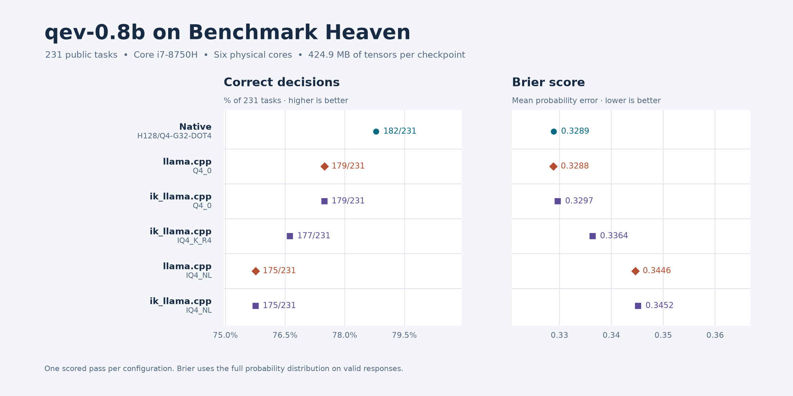

# qev-0.8b Q4 quality on Benchmark Heaven

Six Qev checkpoint and server combinations answered the same 231 public
Benchmark Heaven text tasks. Every weight file contains 424,934,656 tensor
bytes. The calibrated H128 artifact ran on the native engine. Both GGUF
engines used the same Q4_0 file and the same IQ4_NL file. The IQ4_K_R4 file
ran on ik_llama.cpp. All three GGUF formats were generated with the pinned
quantizers in pure mode from the same publisher BF16 source.
[Previous latency comparison](qev-i7-server-comparison.md) · [Qev BF16 source](https://huggingface.co/labqoat/qev-0.8b-GGUF/tree/9550cc0d3f0e8f651cced8469ddfb89acc58c26d)

The [precision comparison](qev-heaven-precision-i7.md) measures decision
quality and speed with native H128 and llama.cpp Q4_K_M, Q8_0 and BF16.

## Accuracy and probability error

| Configuration | Correct / 231 | Accuracy | Brier ↓ | Original / 72 | Easy / 48 | Hard / 111 | Valid |
| --- | ---: | ---: | ---: | ---: | ---: | ---: | ---: |
| Native H128/Q4-G32-DOT4 | 182 | 78.79% | 0.3289 | 68 | 48 | 66 | 231/231 |
| llama.cpp Q4_0 | 179 | 77.49% | 0.3288 | 66 | 47 | 66 | 231/231 |
| ik_llama.cpp Q4_0 | 179 | 77.49% | 0.3297 | 66 | 47 | 66 | 231/231 |
| ik_llama.cpp IQ4_K_R4 | 177 | 76.62% | 0.3364 | 66 | 47 | 64 | 231/231 |
| llama.cpp IQ4_NL | 175 | 75.76% | 0.3446 | 65 | 48 | 62 | 231/231 |
| ik_llama.cpp IQ4_NL | 175 | 75.76% | 0.3452 | 64 | 48 | 63 | 231/231 |

Native H128 had the highest accuracy on this panel. Q4_0 produced the best
GGUF accuracy and Brier score on both engines. Native H128 and llama.cpp
Q4_0 both round to 0.329 Brier at three decimal places.

The pinned upstream scorer takes the highest-probability label for all
three question types and resolves exact ties by lexicographic label order.
An invalid response counts as a miss. Brier is the mean sum of squared
probability errors on valid distributions, with lower values better.
The public tasks include related variants of the same scenario.
[Task set and scorer](https://github.com/fstandhartinger/jevbench/tree/1bcc55eb6c8cffde2306b3db03ede39b61c6152a)

## Paired comparisons

For each pair, the middle columns count the tasks on which exactly one
configuration got the reference answer right.

| First | Second | First only | Second only | Same predicted label |
| --- | --- | ---: | ---: | ---: |
| Native H128/Q4-G32-DOT4 | llama.cpp Q4_0 | 9 | 6 | 213/231 |
| llama.cpp Q4_0 | llama.cpp IQ4_NL | 9 | 5 | 212/231 |
| ik_llama.cpp Q4_0 | ik_llama.cpp IQ4_NL | 9 | 5 | 213/231 |
| ik_llama.cpp Q4_0 | ik_llama.cpp IQ4_K_R4 | 7 | 5 | 217/231 |
| ik_llama.cpp IQ4_NL | ik_llama.cpp IQ4_K_R4 | 4 | 6 | 218/231 |
| llama.cpp Q4_0 | ik_llama.cpp Q4_0 | 0 | 0 | 231/231 |
| llama.cpp IQ4_NL | ik_llama.cpp IQ4_NL | 1 | 1 | 228/231 |

The shared GGUF comparisons hold the weights fixed. Each native-to-GGUF
comparison includes both the quantization and the server implementation.

## Protocol

The benchmark used the same CPU-only server builds as the i7 latency study
on cores 0–5 with six inference threads and one resident model. All runs
submitted the same ordered request bodies through `POST /v1/systemone`.
Native prefix caching was disabled. llama.cpp cleared its slot between
decisions. ik_llama.cpp used zero context checkpoints, and its logs
verified a fresh prompt for every decision. The servers returned zero
generated tokens.
The five GGUF setups reported identical input token counts for every task.
Native reported one additional input token on 54 tasks. Each server used
its own tokenizer and System One prompt rendering.

The PowerShell sequential runner executed one scored pass per configuration.
The local harness records the returned distributions and uses the upstream
question builder, distribution scorer and Brier function from the pinned
dataset revision. The manifest records request, model and binary hashes.

[Summary](../results/qev-heaven-i7-2026-11-21/summary.csv) · [Per-task predictions](../results/qev-heaven-i7-2026-11-21/predictions.csv) · [All paired comparisons](../results/qev-heaven-i7-2026-11-21/paired.csv) · [Commands and SHA-256 manifest](../results/qev-heaven-i7-2026-11-21/manifest.json)
