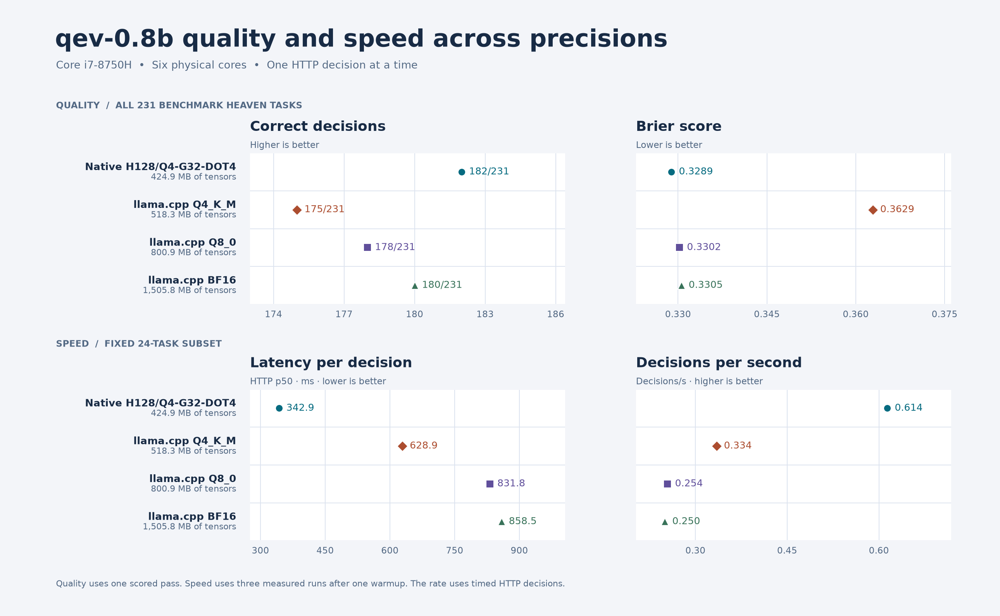

# qev-0.8b precision comparison on the Core i7-8750H

The native H128/Q4-G32-DOT4 checkpoint and three llama.cpp formats answered
the same 231 public Benchmark Heaven tasks over System One HTTP. The speed
test repeated a fixed 24-task subset on six physical cores. The publisher's
BF16 checkpoint is the precision reference. Q8_0 is the matching published
GGUF, and Q4_K_M was generated from BF16 with the pinned llama.cpp quantizer
using its default mixed layout.
[Equal-size Q4 comparison](qev-heaven-i7.md) · [Publisher checkpoint revision](https://huggingface.co/labqoat/qev-0.8b-GGUF/tree/9550cc0d3f0e8f651cced8469ddfb89acc58c26d)

Native H128 had the most correct decisions and the lowest Brier score on
this panel. BF16 answered two fewer questions correctly. Native H128
processed 2.46 times as many decisions per second as BF16, whose
tensor payload was 3.54 times as large.

## Quality

| Configuration | Tensor MB | GGUF or Q35H file MB | Correct / 231 | Accuracy | Brier ↓ |
| --- | ---: | ---: | ---: | ---: | ---: |
| Native H128/Q4-G32-DOT4 | 424.9 | 425.0 | 182 | 78.79% | 0.3289 |
| llama.cpp Q4_K_M | 518.3 | 529.3 | 175 | 75.76% | 0.3629 |
| llama.cpp Q8_0 | 800.9 | 811.8 | 178 | 77.06% | 0.3302 |
| llama.cpp BF16 | 1,505.8 | 1,516.7 | 180 | 77.92% | 0.3305 |

All responses were valid. The upstream scorer chooses the highest-probability
label and breaks ties lexicographically. Brier is the mean sum of squared
probability errors across labels. Lower values indicate smaller errors.
Related task variants are included in the public set.
[Task set and scorer](https://github.com/fstandhartinger/jevbench/tree/1bcc55eb6c8cffde2306b3db03ede39b61c6152a)

| Compared with native H128 | H128 only correct | llama.cpp only correct | Same predicted label / 231 |
| --- | ---: | ---: | ---: |
| llama.cpp Q4_K_M | 10 | 3 | 216 |
| llama.cpp Q8_0 | 6 | 2 | 218 |
| llama.cpp BF16 | 4 | 2 | 220 |

## Speed

| Configuration | HTTP p50, ms | HTTP p95, ms | Decisions/s |
| --- | ---: | ---: | ---: |
| Native H128/Q4-G32-DOT4 | 342.9 | 6,597.1 | 0.614 |
| llama.cpp Q4_K_M | 628.9 | 12,457.6 | 0.334 |
| llama.cpp Q8_0 | 831.8 | 16,277.9 | 0.254 |
| llama.cpp BF16 | 858.5 | 16,518.7 | 0.250 |

## Protocol

Each test used six inference threads pinned to physical cores 0–5, CPU-only
inference, one resident model and one request at a time. The host ran on AC
with the Intel P-state maximum performance setting at 80%. Each endpoint
received the same ordered request bodies. Native prefix caching was disabled,
and the harness cleared the llama.cpp slot between requests. The servers
processed each prompt afresh and returned zero generated tokens.

The quality series used one scored pass per llama.cpp format and reused the
frozen native pass from the equal-size comparison. The speed series uses the same
native model and binary and draws its requests from that full set. Each engine used its own tokenizer
and System One prompt rendering.
All three GGUFs used the same input token count on each task. Native used one
additional token on 54 tasks.

The speed series used seven original, five easy and twelve hard tasks.
Within each tier, the selection takes the midpoint from equal intervals of
the task ranks by input length. The previous Q4_0 run supplied the input
lengths, ranging from 64 to 3,382 tokens among the selected tasks. Task
ordering follows the full set. The sequential PowerShell runner
used one warmup and three measured passes per configuration with alternating
case order. The table reports the median across the three measured passes
for each metric. Latency covers the HTTP round trip for each decision.
Decisions/s divides the task count by the sum of these request durations.
Server startup and slot resets were outside these timers. For each format,
all distributions on the 24 speed tasks matched the corresponding full
quality pass in every repetition.
The speed series recorded zero added thermal-throttle events.

[Quality summary](../results/qev-heaven-precision-i7-2026-11-21/quality.csv) · [Predictions](../results/qev-heaven-precision-i7-2026-11-21/predictions.csv) · [Paired comparisons](../results/qev-heaven-precision-i7-2026-11-21/paired.csv) · [Speed summary](../results/qev-heaven-precision-i7-2026-11-21/speed.csv) · [Speed samples](../results/qev-heaven-precision-i7-2026-11-21/speed-samples.csv) · [Commands and SHA-256 manifest](../results/qev-heaven-precision-i7-2026-11-21/manifest.json)
