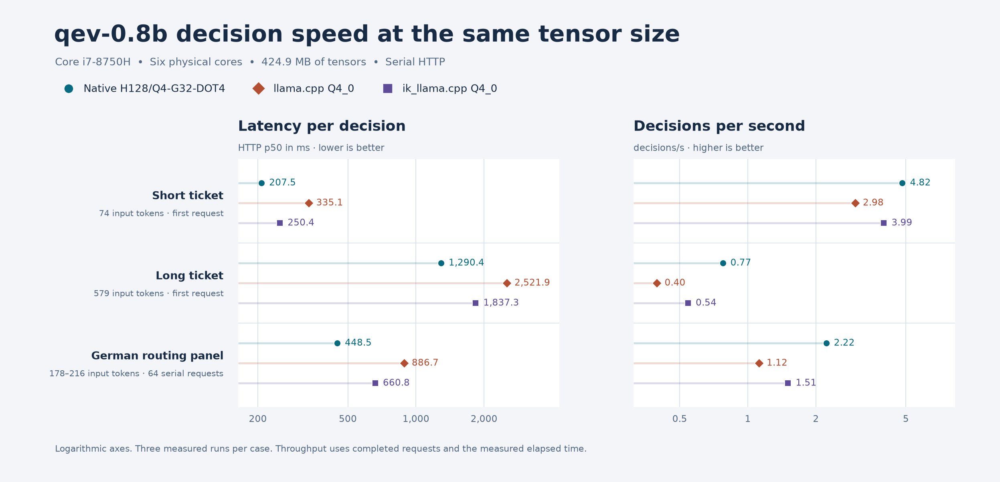

# qev-0.8b System One performance on the Core i7-8750H

Native, llama.cpp and ik_llama.cpp all served the same 66 single-question
fixtures through `POST /v1/systemone` on six physical cores. The GGUF servers
loaded the same stock `nimble` decision metadata and System One template.
The November 21, 2026 tests use the engine revisions from the CPU comparison.
[llama.cpp server API](https://github.com/ggml-org/llama.cpp/blob/7170cad4d02f7907517613931840cbb2367399a3/tools/server/README.md#post-v1systemone-typesafe-compatible-system-one-api) · [ik_llama.cpp System One support](https://github.com/ikawrakow/ik_llama.cpp/pull/2592)

## 424.9 MB of tensors

The native H128/Q4-G32-DOT4 checkpoint and the pure Q4_0 GGUF each store
**424,934,656 tensor bytes**. Their files are 424,964,864 and 435,898,528
bytes, respectively. Both GGUF runtimes loaded the same Q4_0 file, generated
from the publisher’s BF16 GGUF with `llama-quantize --pure … Q4_0 6`. The
native file uses its published calibration and tensor representation.
[Publisher weights and metadata](https://huggingface.co/labqoat/qev-0.8b-GGUF/tree/9550cc0d3f0e8f651cced8469ddfb89acc58c26d) · [Native calibration](decision-quality.md)



Each cell shows HTTP p50 in milliseconds and measured decisions per second.
Both are medians of three runs.

| Engine and quantization | Short ticket | Long ticket | German routing panel |
| --- | ---: | ---: | ---: |
| Native H128/Q4-G32-DOT4 | 207.5 ms / 4.82/s | 1,290.4 ms / 0.77/s | 448.5 ms / 2.22/s |
| llama.cpp Q4_0 | 335.1 ms / 2.98/s | 2,521.9 ms / 0.40/s | 886.7 ms / 1.12/s |
| ik_llama.cpp Q4_0 | 250.4 ms / 3.99/s | 1,837.3 ms / 0.54/s | 660.8 ms / 1.51/s |

## 800.9 MB of tensors

Both GGUF servers also loaded the same published text Q8_0 file, which
stores 800,881,920 tensor bytes.

| Engine and quantization | Short ticket | Long ticket | German routing panel |
| --- | ---: | ---: | ---: |
| llama.cpp Q8_0 | 423.0 ms / 2.36/s | 3,038.7 ms / 0.33/s | 1,085.4 ms / 0.92/s |
| ik_llama.cpp Q8_0 | 256.4 ms / 3.90/s | 1,844.9 ms / 0.54/s | 669.7 ms / 1.49/s |

## Requests and output agreement

The 74-token and 579-token tickets time the first request after each fresh
server becomes ready. The routing panel sends the same 64 distinct German
requests serially to one resident server. The inputs have 178–216 tokens.
All timings include local HTTP, tokenization, inference and response
formatting. Throughput divides completed decisions by the total time spent
sending the requests. Server startup and weight loading are outside the timer.

Input token counts matched for every fixture. Every request returned zero
generated tokens and reused zero prompt tokens. The checks read the native
response cache count, llama.cpp’s post-run cache metric, and each
ik_llama.cpp request’s starting KV position in the server log.

| Comparison | Same selected option | Largest probability difference |
| --- | ---: | ---: |
| llama.cpp Q4_0 vs ik_llama.cpp Q4_0 | 62/66 | 4.43 percentage points |
| llama.cpp Q8_0 vs ik_llama.cpp Q8_0 | 62/66 | 3.09 percentage points |
| Native H128/Q4-G32-DOT4 vs llama.cpp Q4_0 | 50/66 | 43.39 percentage points |
| Native H128/Q4-G32-DOT4 vs ik_llama.cpp Q4_0 | 48/66 | 45.86 percentage points |
| llama.cpp Q4_0 vs llama.cpp Q8_0 | 47/66 | 48.32 percentage points |
| ik_llama.cpp Q4_0 vs ik_llama.cpp Q8_0 | 46/66 | 50.62 percentage points |

Each build gave stable choices and probabilities across the four runs.
Agreement measures equivalence on these fixtures. Task accuracy is measured
in the separate [Qev evaluation](decision-quality.md).

## Run settings and evidence

The CPU-only Release builds used native `a3e9935`, llama.cpp `7170cad` and
ik_llama.cpp `98aca86`. Runs used CPUs 0–5, six inference threads, one slot
per server, an 8,192-token context and FP16 KV. Both GGUF servers used batch
2,048, microbatch 256 and `--cache-ram 0`. Both used their default weight
repacking settings. Native used its adaptive prefill setting. The i7 ran
on AC with turbo enabled, the Intel P-state
`powersave` governor, `balance_power` and `max_perf_pct=80`.

The sequential runner executed one warmup and three measured runs per case
and reversed case order on alternate passes. The peak package temperature
was 67 °C and the recorded thermal throttle counters were unchanged.

Extract the matrix from the manifest and resolve the local input, harness
and binary paths. The harness patch adds the llama.cpp cache metrics check
after the measured requests.

```bash
OMP_NUM_THREADS=6 taskset -c 0-5 pwsh -NoProfile -File scripts/benchmark-inference-seq.ps1 \
    -Matrix "$matrix" -OutputDir "$out" -WarmupRuns 1 -Runs 3 -Affinity 63
```

[Medians and ranges](../results/qev-i7-servers-2026-11-21/summary.csv) · [Individual samples](../results/qev-i7-servers-2026-11-21/samples.csv) · [Choice agreement](../results/qev-i7-servers-2026-11-21/choice-agreement.json) · [Commands and SHA-256 manifest](../results/qev-i7-servers-2026-11-21/manifest.json)
