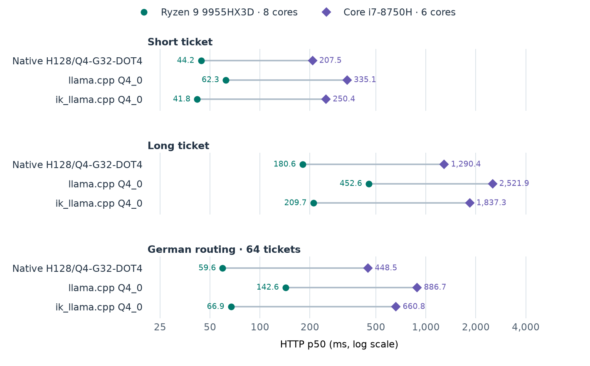

# Qev decision serving on the Ryzen 9 9955HX3D and Core i7-8750H

On November 22, 2026, the Ryzen repeated the [November 21 Intel server comparison](qev-i7-server-comparison.md) using the same 66 inputs, server revisions, benchmark harness and weight files. Both machines ran one HTTP request at a time. The Ryzen used eight physical V-Cache cores and the i7 used six physical cores.

Native H128 processed **16.65 German tickets/s** on the Ryzen and **2.22/s** on the i7. Its median latency on the Ryzen was 59.6 ms, followed by ik_llama.cpp Q4_0 at 66.9 ms and llama.cpp Q4_0 at 142.6 ms. Native also had the lowest median on the long ticket. On the short Ryzen ticket, ik_llama.cpp Q4_0 led native by 2.4 ms. Native led all three workloads on the i7.



## HTTP latency and throughput

Each cell with two numbers shows **Ryzen / i7**. Latency is in milliseconds. The final column divides Intel p50 by Ryzen p50. H128 and Q4_0 each contain 424,934,656 tensor bytes. Q8_0 contains 800,881,920 bytes.

| Workload | Server and checkpoint | p50, ms | p95, ms | Decisions/s | i7 / Ryzen p50 |
| --- | --- | ---: | ---: | ---: | ---: |
| Short ticket | Native H128/Q4-G32-DOT4 | 44.2 / 207.5 | 44.2 / 207.5 | 22.64 / 4.82 | 4.70× |
| Short ticket | llama.cpp Q4_0 | 62.3 / 335.1 | 62.3 / 335.1 | 16.06 / 2.98 | 5.38× |
| Short ticket | ik_llama.cpp Q4_0 | 41.8 / 250.4 | 41.8 / 250.4 | 23.93 / 3.99 | 5.99× |
| Short ticket | llama.cpp Q8_0 | 94.1 / 423.0 | 94.1 / 423.0 | 10.62 / 2.36 | 4.49× |
| Short ticket | ik_llama.cpp Q8_0 | 46.2 / 256.4 | 46.2 / 256.4 | 21.66 / 3.90 | 5.55× |
| Long ticket | Native H128/Q4-G32-DOT4 | 180.6 / 1,290.4 | 180.6 / 1,290.4 | 5.54 / 0.77 | 7.14× |
| Long ticket | llama.cpp Q4_0 | 452.6 / 2,521.9 | 452.6 / 2,521.9 | 2.21 / 0.40 | 5.57× |
| Long ticket | ik_llama.cpp Q4_0 | 209.7 / 1,837.3 | 209.7 / 1,837.3 | 4.77 / 0.54 | 8.76× |
| Long ticket | llama.cpp Q8_0 | 750.0 / 3,038.7 | 750.0 / 3,038.7 | 1.33 / 0.33 | 4.05× |
| Long ticket | ik_llama.cpp Q8_0 | 213.0 / 1,844.9 | 213.0 / 1,844.9 | 4.69 / 0.54 | 8.66× |
| German routing | Native H128/Q4-G32-DOT4 | 59.6 / 448.5 | 64.4 / 479.3 | 16.65 / 2.22 | 7.53× |
| German routing | llama.cpp Q4_0 | 142.6 / 886.7 | 154.4 / 963.0 | 7.00 / 1.12 | 6.22× |
| German routing | ik_llama.cpp Q4_0 | 66.9 / 660.8 | 73.3 / 711.2 | 14.78 / 1.51 | 9.87× |
| German routing | llama.cpp Q8_0 | 222.2 / 1,085.4 | 241.1 / 1,183.9 | 4.47 / 0.92 | 4.88× |
| German routing | ik_llama.cpp Q8_0 | 71.2 / 669.7 | 76.0 / 719.4 | 13.99 / 1.49 | 9.40× |

The short and long tickets contain 74 and 579 input tokens. Each is the first call after a fresh server becomes ready, so its within-run p50 and p95 coincide. The routing workload sends 64 distinct German tickets of 178–216 tokens through one resident server. Throughput divides completed requests by elapsed HTTP time, including response formatting. Model loading and startup precede the timer. Each reported statistic is the median of three measured runs.

## Decisions across CPUs

The first measured pass on each host supplied the 66 paired answers per configuration. The Ryzen also reproduced its own choices and probability distributions across all four passes. The table measures agreement on the selected option and maximum absolute probability drift across corresponding options. The tickets have no ground-truth labels in this speed test.

| Server and checkpoint | Same choice / 66 | Maximum probability difference, percentage points |
| --- | ---: | ---: |
| Native H128/Q4-G32-DOT4 | 65 | 2.14 |
| llama.cpp Q4_0 | 64 | 3.45 |
| ik_llama.cpp Q4_0 | 64 | 4.81 |
| llama.cpp Q8_0 | 63 | 3.30 |
| ik_llama.cpp Q8_0 | 66 | 2.97 |

## Measurement settings

The Ryzen ran on AC in the max-power platform profile with CPUs 0–7 in its 96 MiB L3 domain (mask 255). The Intel reference used CPUs 0–5 (mask 63), AC, turbo and its recorded 80% Intel P-state maximum. Each CPU used local Release binaries. Native used the Ryzen server binary previously verified for core revision `a3e9935`. Both llama.cpp `7170cad` and ik_llama.cpp `98aca86` were built on this host with native CPU instructions, BLAS off and CUDA off. The builds used the original decision template. Each GGUF server used one slot, context 8,192, batch 2,048 and microbatch 256. Native used adaptive prefill. The sampled peak Ryzen Tctl was 103.9 °C.

Every run reported zero generated tokens. Native cache-read counters, llama.cpp cached-prompt metrics and ik_llama.cpp starting KV positions confirmed zero cached tokens for all requests. Token counts agreed across all servers and both CPUs. The sequential runner executed one warmup and three measured passes in alternating case order. The per-run CSV includes warmups for inspection.

To repeat, build the three recorded revisions, verify the checkpoint and fixture hashes and adapt the paths in the saved matrix. The exact HTTP harness can be recreated by applying the patch in the [Intel manifest](../results/qev-i7-servers-2026-11-21/manifest.json) to its recorded base. Run from the repository root.

```bash
OMP_NUM_THREADS=8 taskset -c 0-7 pwsh -NoProfile -File scripts/benchmark-inference-seq.ps1 \
  -Matrix "$matrix" -OutputDir "$out" -WarmupRuns 1 -Runs 3 -Affinity 255
```

[CPU comparison CSV](../results/qev-ryzen-servers-2026-11-22/comparison.csv) · [Individual samples](../results/qev-ryzen-servers-2026-11-22/samples.csv) · [Per-ticket choices and probabilities](../results/qev-ryzen-servers-2026-11-22/answers.csv) · [Commands, hashes and environment](../results/qev-ryzen-servers-2026-11-22/manifest.json)
