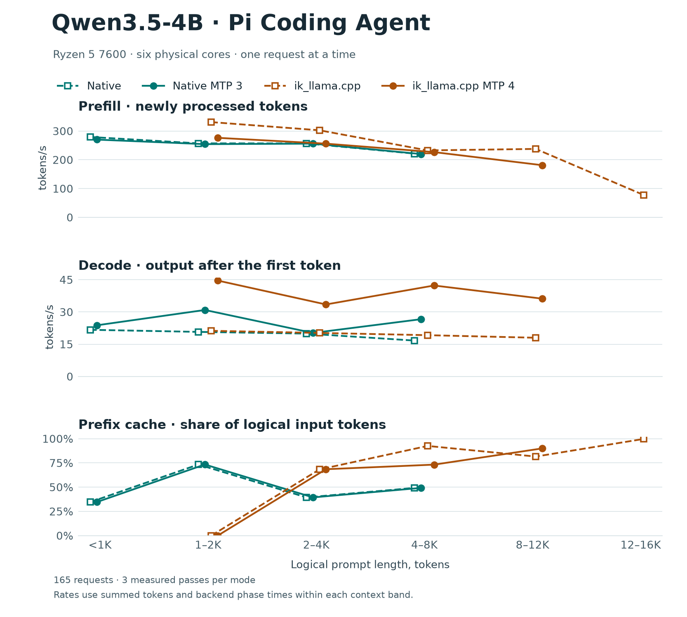

# Qwen3.5-4B Pi Coding Agent on Ryzen 5 7600

The Pi Coding Agent benchmark compares four CPU-only server configurations
using models quantized from the same Qwen3.5-4B snapshot. It measures a
complete file-editing session, a fixed cold/warm continuation and offline
browser checks.

The [optimized native verifier and tool checkpoints](#optimized-native-verifier-and-tool-checkpoints) section gives the follow-up results on the same machine.

## Agent sessions

The table reports the median elapsed time for all four user turns across
three measured runs. The Browser column counts checks at the last turn.
Earlier checks are rerun against the final file.

| Backend | Session | Logical input tokens | Cached input | Output tokens | Browser | Successful tool calls |
| --- | ---: | ---: | ---: | ---: | ---: | ---: |
| Native, MTP off | 476.52 s | 43,242 | 51.1% | 6,572 | 0/12 | 2/11 |
| Native, MTP depth 3, corrected server | 328.81 s | 43,242 | 51.1% | 6,572 | 0/12 | 2/11 |
| ik_llama.cpp, MTP off | 394.55 s | 89,859 | 84.0% | 6,569 | 1/12 | 7/9 |
| ik_llama.cpp, MTP depth 4 | 203.13 s | 100,685 | 84.0% | 5,147 | 0/12 | 8/11 |

The native configurations produced the same SSE choices, tool arguments,
usage and byte-identical files at every checkpoint in all three measured
runs. Session time fell by 31.0% on that identical trajectory. The ik_llama.cpp
sessions followed different tool trajectories with different token counts
and cache hit rates. The raw continuation provides the fixed-request speed
comparison separately.

The native agent said it had written the initial file before it made a write
call. Follow-up reads failed until the third turn, when the agent wrote a
file whose toggle loop destructured scalar coordinates. The ik_llama.cpp
MTP agent wrote its first file immediately. That implementation toggled
diagonals and omitted required native buttons. Its later edits still missed
the game contract. With MTP off, ik_llama.cpp passed the win check.

The chart pools all 165 measured requests in logical prompt length bands.
Within each band, prefill divides newly processed tokens by total prefill
time. Decode divides output after the first token by total reported decode
time, using requests with at least two outputs. The 4K–8K band measured
221.3/16.7 tok/s for native without MTP and 219.9/26.6 tok/s with MTP.
ik_llama.cpp measured 232.5/19.2 tok/s without MTP and 226.6/42.3 tok/s with
MTP. Native prompts reached 8,077 tokens and ik_llama.cpp prompts reached
12,456. Backend phase counters differ in how they attribute sampling, with
native ordinary decode reporting forward time and MTP verification also
including target token selection.

## HTTP output draining

The original HTTP loop consumed one confirmed token per scheduler step.
Native MTP depth three could confirm four in one step. The 256-token output
buffer filled during long replies and left only one slot per step, so the
verifier fell back to ordinary decode. The corrected loop consumes the
whole available block within the streaming queue budget. It still checks
each token for UTF-8 boundaries and byte stops.

The 1,857-token structured write retained identical tool arguments while
accepted drafts rose from 255 to 1,325. Across the complete native session
draft acceptance rose from 1,441 to 4,818. Median session time dropped from
433.58 s to 328.81 s, a 24.2% reduction versus native MTP before the fix.
The primary table uses the three corrected MTP runs. The other three modes
use their original three measured runs. The pre-fix native MTP rows and
the corrected measurements are retained together as separate evidence.

## MTP prefix cache control

The fixed continuation has a 2,599-token common prefix and four new tokens
on the follow-up. All modes below generated 144 tokens. The reported times
are medians over three runs.

| Backend | Cached follow-up tokens | First output | Full follow-up |
| --- | ---: | ---: | ---: |
| Native MTP depth 3, before prefix reuse | 0 | 9.431 s | 12.802 s |
| Native MTP depth 3, with prefix reuse | 2,599 | 0.082 s | 3.547 s |
| ik_llama.cpp MTP depth 4 | 2,594 | 0.131 s | 3.11 s |

The native server saved 72.3% of follow-up wall time. It returned the same
text before and after the change in every measured pass. MTP drafts use
request-local copies of the sidecar KV. Snapshot compatibility includes the
loaded model, layout, namespace and exact prompt tokens. The cache budget
includes the saved sidecar rows.

## Fixed-request rates

The cold request prefills 2,599 tokens. The follow-up appends four tokens
to the same prompt and asks for a 144-token continuation. Prefill uses
each engine's prompt-processing counter. Decode divides the remaining 143
output tokens by the elapsed time from first output to last output on the
shared streaming interface. The cold and follow-up requests can generate
different continuations, which also changes speculative acceptance.
These 144-token samples precede the output-drain fix and fit within the old
buffer without a stall.

| Backend | Cold prefill, tok/s | Cold decode, tok/s | Follow-up decode, tok/s |
| --- | ---: | ---: | ---: |
| Native, MTP off | 276.2 | 19.9 | 20.0 |
| Native, MTP depth 3 with prefix reuse | 276.0 | 23.8 | 41.3 |
| ik_llama.cpp, MTP off | 327.8 | 21.1 | 21.1 |
| ik_llama.cpp, MTP depth 4 | 272.7 | 28.3 | 48.1 |

## Optimized native verifier and tool checkpoints

A second series used native commit `2465c50`. The CPU, model files, Pi version, browser fixture, six-core affinity, sampling settings and 512 MiB cache matched the comparison above. Each configuration ran sequentially with one warmup and three measured passes. All times in the next two tables are medians. Agent decode rates use the native phase counter and fixed continuations use the first and last streamed tokens.

| Native agent configuration | Four turns | New prefill tokens | Cached input | Prefill time | Decode time | Agent decode, tok/s |
| --- | ---: | ---: | ---: | ---: | ---: | ---: |
| Previous MTP-3 | 328.81 s | 21,147 | 51.1% | 91.35 s | 237.10 s | 27.6 |
| Optimized MTP-3 | 243.27 s | 11,903 | 72.5% | 50.29 s | 192.64 s | 34.0 |
| Optimized MTP-4 | 234.33 s | 11,903 | 72.5% | 50.34 s | 183.81 s | 35.7 |

At depth four the native agent used 28.7% less elapsed time than the previous depth-three implementation. At logical prompts of 4K–8K, optimized native depth three measured 31.9 decode tokens/s and depth four measured 33.9. The earlier native MTP-3 and ik_llama.cpp MTP-4 comparison measured 26.6 and 42.3 tokens/s in this band.

Each measured native run matched all 14 baseline responses and all four filesystem checkpoints, including the missing file on turns one and two. Pi generated 6,572 tokens and the final game passed 0/12 browser checks. The longer tool checkpoints served 31,339 of 43,242 input tokens. The original cache served 22,095. The final 8,077-token prompt restored 7,507 tokens. A change of user turn did lose one earlier 889-token hit under the same cache budget.

The earlier ik_llama.cpp MTP-4 session took 203.13 s, generated 5,147 tokens and passed 0/12 checks. Its agent followed a different sequence of tool calls. The following fixed-request series reran both engines on the same two prompts with a 144-token output limit. The cold continuations differed between engines. The warm continuation was byte-identical across all native and ik_llama.cpp modes.

| Backend | Cold decode, tok/s | Warm decode, tok/s | First warm output | Full warm request |
| --- | ---: | ---: | ---: | ---: |
| Previous native ordinary | 20.2 | 20.1 | 80 ms | 7.196 s |
| Optimized native ordinary | 20.3 | 20.3 | 80 ms | 7.136 s |
| Previous native MTP-3 | 24.5 | 43.3 | 81 ms | 3.403 s |
| Optimized native MTP-2 | 33.8 | 39.3 | 80 ms | 3.721 s |
| Optimized native MTP-3 | 32.7 | 45.7 | 83 ms | 3.212 s |
| Optimized native MTP-4 | 32.2 | 47.0 | 80 ms | 3.122 s |
| ik_llama.cpp MTP-2 | 30.8 | 39.9 | 154 ms | 3.758 s |
| ik_llama.cpp MTP-4 | 28.6 | 48.5 | 155 ms | 3.111 s |

At depth four, cold prefill measured 276.3 tok/s on native and 268.0 tok/s on ik_llama.cpp using the backend phase counters. The complete warm requests finished 11 ms apart in the median.

The verifier retains accepted target KV rows and saves the middle linear-layer input projections. After a partial match it can advance the recurrent state without a second target-model forward. An instrumented baseline on the complete 1,857-token tool write spent 6.64 s replaying accepted positions and 0.94 s copying recurrent checkpoints. Transformer matrix projections excluding the output head took 21.29 s, the vocabulary projection took 3.56 s, full attention took 4.41 s, linear attention took 1.43 s and target token selection took 4.42 s. The counters cover the verifier. The separate MTP proposal phase took 16.74 s.

Additional changes batch two, three and five independently prepared Q4 DOT4 inputs on AVX-512 VNNI, use a 16-output-row tile for four input rows, and process attention values in context blocks. Greedy JSON selection tests the highest finite logit before building the fallback heap. A tool result can now extend the retained chat checkpoint. The engine releases the consumed handle when a larger snapshot needs its cache space.

During screening, a request-local controller explored MTP depths 2–4 and ranked them by elapsed time per committed token. On the complete tool write it took 50.75 s, compared with 49.75 s for fixed depth four. Parallel recurrent checkpoint copying and a 32-output-row tile also stayed experimental. Screening timings are retained separately from the repeated comparisons.

The [optimization evidence](../results/qwen35-4b-agent-2026-11-19/native-optimization.json) records the measured runs, binary hashes, exact output checks and server commands. To reproduce, use the Pi fixture and fixed-request commands below with the new native binary at depths 2–4. The agent series uses depths three and four. The [long tool fixture](../../tests/fixtures/qwen35-mtp-long-tool.json) reproduces the isolated write. Local profiles and browser artifacts are under `benchmarks/ryzen-mtp-tuning/`.

## Matched long-context MTP decode

The five-row verifier computes attention for the pending token and four MTP proposals together. On the AVX2 FP16 KV path each query head shares a key or value tile across five positions. Each position retains its causal mask and the arithmetic order of single-row decode. The kernel supports contiguous and paged caches.

Single-request decode in tokens/s on the Ryzen 5 7600, median of three measured runs after one warmup per configuration. All five configurations ran sequentially with the same six physical cores, at temperature zero and the same 16,384-token context capacity.

| Prompt tokens | Native ordinary | ik ordinary | Previous native MTP-4 | New native MTP-4 | ik MTP-4 | Native MTP-4 gain |
| ---: | ---: | ---: | ---: | ---: | ---: | ---: |
| 4,096 | 19.3 | 20.6 | 48.0 | 49.7 | 50.0 | +3.7% |
| 8,192 | 15.8 | 18.4 | 33.1 | 40.1 | 42.7 | +21.3% |
| 12,288 | 13.1 | 17.5 | 22.9 | 32.0 | 31.9 | +39.8% |

Every prompt repeats `01234567` up to the exact length in the table. Each backend continued the pattern for the same 128 tokens using its own greedy decode. The harness checks the exact output bytes, both token counts and the length stop on every request. Each digit occupies one Qwen token. Decode throughput divides 127 tokens by the elapsed time from the first to the last nonempty SSE choice, excluding prefill and startup. The native target and MTP sidecar use H128/Q4-G32-DOT4. The ik_llama.cpp artifact uses IQ4_K_R4. Both artifacts came from the same target checkpoint.

All MTP configurations accepted all 101 proposed tokens on every measured request. This high-acceptance workload isolates verification costs at matched sequence positions. Coding requests with partial matches can have different throughput. At 12,288 prompt tokens the native verifier took 4.45 s before and 2.87 s after the change for the 128-token continuation.

A separate native check with the same continuation measured 58.4, 57.5 and 55.4 tok/s at 128, 512 and 1,024 prompt tokens before the change. The new kernel measured 58.6, 58.4 and 56.8 tok/s respectively.

The [individual runs](../results/qwen35-4b-agent-2026-11-19/matched-context.csv) include phase timings and draft counts. The [manifest](../results/qwen35-4b-agent-2026-11-19/matched-context-manifest.json) records the binaries, checkpoint hashes, affinity and server commands. To reproduce, use the sequential runner with one matrix entry per server configuration. Each entry invokes `scripts/benchmark-pi-agent.py --config CONFIG --synthetic-context 4096 8192 12288 --synthetic-output 128`. CONFIG contains the recorded engine, depth and server command, omitting the final ephemeral port option. The runner appends the profile output path.

## Quantization fidelity

A separate full-logit evaluation used the same 238 forced continuation
positions for BF16, native H128/Q4-G32-DOT4 and ik_llama.cpp IQ4_K_R4.
The two candidates used fresh CPU logits and the same archived reference.
The model runs used ordinary decode for this test.

| 4B artifact | Pooled perplexity ↓ | Mean KL from BF16 ↓ | BF16 top-1 agreement ↑ |
| --- | ---: | ---: | ---: |
| BF16 reference | 10.6716 | 0 | 100% |
| Native H128/Q4-G32-DOT4, unweighted MSE16 | 10.1788 | 0.15017 | 87.39% |
| ik_llama.cpp pure IQ4_K_R4 | 10.2794 | 0.18032 | 89.92% |

The pooled perplexities differ by about 1%. H128 has the lower pooled KL,
driven by the 128-token English window. IQ4_K_R4 has lower KL on the
editing, transcript and code windows. On the 41 code positions its
perplexity was 2.8669 versus H128's 3.0539 and BF16's 2.7811. Code-window
top-1 agreement favored H128, at 92.68% versus 90.24%. These scores measure
continuation fidelity on four fixed windows. The browser score measures the
whole agent stack, which also includes each server's tool formatting, token
selection and request flow.

The full vocabulary, pinned reference and per-window results are retained
with the [quantization evidence](../results/qwen35-4b-agent-2026-11-19/quantization-quality.json)
and [reference token sequences](../results/qwen35-4b-ryzen-2026-11-19/reference-windows.json).

## Workload

The installed Pi Coding Agent 1.5.0 stayed in one RPC session for four user
requests. The user asked it to build an offline Beacon Switch game, add
one-step Undo, add keyboard navigation, then add board-size selection. Pi
executed its built-in read, write and edit tools in a new isolated workspace for each
pass. The two servers received equivalent tools and sampling settings. The
adapter added explicit closed object schemas to Pi's declared file-tool
parameters, selected the correct model ID and enabled the target engine's
MTP mode. It requested single tool calls, temperature 0 and no reasoning.
The maximum per model completion was 1,900 tokens and each user turn had
up to six model requests. An offline Chromium judge tested the saved app
after each user turn and repeated the earlier checks to catch regressions.

One warmup and three measured passes ran sequentially per configuration,
with alternating case order. Each pass started a fresh server with one
resident sequence, a 16,384-token context and a 512 MiB prefix cache.
Pi's startup, server load and browser scoring are outside the measured
agent time. Request wall time includes HTTP and serialization. Tool-enabled
native responses buffer the structured event until the reply completes.
The fixed raw completion probe measures time to first output and time
between first and last output with the same 144-token output budget.

## Models and runtime

Both targets were generated from the same
[pinned Qwen3.5-4B checkpoint](https://huggingface.co/Qwen/Qwen3.5-4B/tree/851bf6e806efd8d0a36b00ddf55e13ccb7b8cd0a).
The native target used its
unweighted MSE16 H128/Q4-G32-DOT4 file and H128 MTP sidecar.
ik_llama.cpp used its own pure IQ4_K_R4 quantizer with the NextN layer
embedded and F32 scalars. The GGUF had 2,369,040,384 bytes of target
tensors and 67,883,008 bytes of MTP tensors before metadata and alignment.
The native files totalled 2,436,965,312 bytes and the GGUF 2,447,892,192,
a 0.45% difference.

Both executables ran on the Ryzen 5 7600 with no GPU offload. The
comparison used GCC 16.2.1 Release builds and taskset. The ik_llama.cpp
build enabled host-native instructions, IQK matrix multiplication and IQK
flash attention. The CPU sweep tested six physical cores versus 12
logical CPUs, microbatches of 256, 512 and 1024, and MTP depths one through
four with `p_min=0.0`. Configuration selection used the median across measured
passes of the first cold request plus twice the cached follow-up latency.
The selected settings were six physical cores, microbatch 512 and MTP depth
four. The [pinned ik_llama.cpp revision](https://github.com/ikawrakow/ik_llama.cpp/commit/ecc288f7da01996cd5d2df66c85a741aeeff4731)
provides the measured server and quantizer.

The native measurement binary adds one stderr record for a completed
request using existing CpuRequestResult counters. The patch leaves the
production server and inference path unchanged. Native prompt/decode
counters attribute timed forward/verification work. The ik_llama.cpp
timings are its server's reported prompt and generation phases. Total
wall time and cache token counts provide the across-server comparisons.

## Evidence and reproduction

The [manifest](../results/qwen35-4b-agent-2026-11-19/manifest.json) records
the commands, binaries, checkpoint hashes, runtime revisions and CPU
masks. The [fixture](../results/qwen35-4b-agent-2026-11-19/beacon-switch.json),
[request samples](../results/qwen35-4b-agent-2026-11-19/requests.csv),
[run summaries](../results/qwen35-4b-agent-2026-11-19/runs.csv),
[browser checks](../results/qwen35-4b-agent-2026-11-19/quality.json),
[tuning samples](../results/qwen35-4b-agent-2026-11-19/tuning.csv) and
[pre-fix MTP samples](../results/qwen35-4b-agent-2026-11-19/requests-native-before-drain.csv)
retain the measured comparisons. Local raw profiles, transcripts and app
snapshots are under `benchmarks/qwen35-4b-agent-2026-11-19/`.

Save each manifest case as a config file and set its `pi` path to the
local Pi Coding Agent package directory. Point the sequential runner's case
at `python scripts/benchmark-pi-agent.py --config CONFIG --fixture FIXTURE`.
Use `-Runs 3 -WarmupRuns 1`. The case command pins the server itself.
Omit the fixture argument to run the prefix probe. Run
`scripts/summarize-pi-agent.py --help` for offline browser scoring and
`scripts/plot-pi-agent.py REQUESTS_CSV OUTPUT_PNG` to regenerate the chart.
