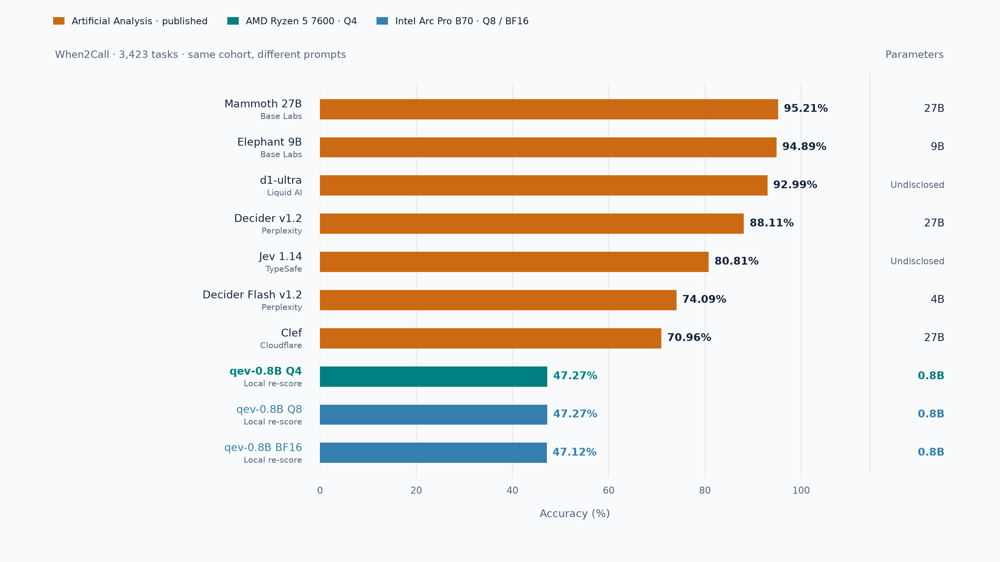
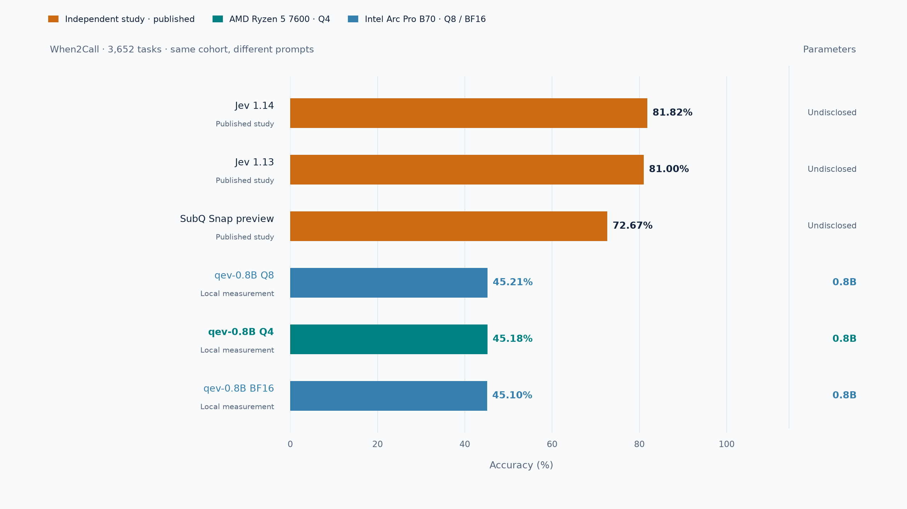

# When2Call: qev and published decision models

Snapshot: November 10, 2026. Larger decision models score substantially higher
than qev on this task. The public Artificial Analysis results range from 62.05%
to 95.21%; qev's existing outputs score about 47% on the same filtered cohort.
This is a comparison of published protocols and a local re-score, rather than
a new run of every model under one harness. qev is not an official AA entry.

## Artificial Analysis cohort: 3,423 tasks



The chart selects the five AA models with size metadata retained here, plus
hosted Jev and d1-ultra references. The [complete 17-model snapshot](../results/when2call-comparison-2026-11-10/aa-reported-results.csv)
is retained, including GLiDE, Drex, Mercury Decide, Celeris and SubQ Snap 1.1.
The horizontal axis is ordinary **accuracy**, not AA's Decision Score or its
weighted Decision Index. Sources: [AA When2Call results](https://artificialanalysis.ai/evaluations/when2call)
and [methodology](https://artificialanalysis.ai/methodology/decision-index#when2call).

| Model | Nominal parameters | Accuracy |
| --- | ---: | ---: |
| Mammoth 27B | 27B | 95.21% |
| Elephant 9B | 9B | 94.89% |
| d1-ultra | Undisclosed | 92.99% |
| Perplexity Decider v1.2 | 27B | 88.11% |
| Jev 1.14 | Undisclosed | 80.81% |
| Perplexity Decider Flash v1.2 | 4B | 74.09% |
| Cloudflare Clef | 27B | 70.96% |
| qev Q4, local re-score | 0.8B | 47.27% |
| qev Q8, local re-score | 0.8B | 47.27% |
| qev BF16, local re-score | 0.8B | 47.12% |

AA removes 229 ambiguous `request_for_info` items from NVIDIA's 3,652-item
test. We apply its published exclusion list to the already saved qev answers;
there is no new inference, prompt change, fitting or checkpoint selection.
All 229 IDs match exactly one excluded ask-information variant each. A source
ID also occurs on the corresponding tool-call and cannot-answer variants:
removing every row with a matching source ID would incorrectly remove 687
tasks. Those sibling variants are retained. The final cohort is exactly 3,423
UUIDs: 1,295 tool-call, 833 ask-information and 1,295 cannot-answer items.

Both methods choose among four candidate replies. AA and our local run use
different prompts and different answer shuffles, so matching the cohort does
not recreate AA's exact harness. These are reference comparisons, not a paired
measurement of model architecture or size alone.

The comparison consistently scores the **explicit API choice**, matching AA's
definition. The original local report used argmax of returned probabilities
with a fixed tie rule. Q4 has one case where four-decimal output rounding
changes that argmax: explicit choice scores 1,650/3,652 (45.18%) and
1,618/3,423 (47.27%), versus the retained probability-argmax scores of 1,651
(45.21%) and 1,619 (47.30%). The original measurements remain unchanged.
Q8 and BF16 have no such difference. Counts for both rules are retained in
[local-rescoring.json](../results/when2call-comparison-2026-11-10/local-rescoring.json).

## Original full test: 3,652 tasks



An [independent decision-model study](https://github.com/sammy143/decision-models-eval/tree/78769cac4a5fa2ca0de16e941a03af6f037cee2c)
publishes per-item outputs for the full original test. We matched all 3,652
UUIDs and gold categories for each model and re-counted its explicit choices:

| Model | Correct / 3,652 | Accuracy |
| --- | ---: | ---: |
| Jev 1.14 | 2,988 | 81.82% |
| Jev 1.13 | 2,958 | 81.00% |
| SubQ Snap preview | 2,654 | 72.67% |
| qev Q8 | 1,651 | 45.21% |
| qev Q4 | 1,650 | 45.18% |
| qev BF16 | 1,647 | 45.10% |

The study's displayed "skill" is chance-corrected: `(accuracy - .25) / .75`.
For example, Snap's 63.56 skill corresponds to 72.67% accuracy, and Jev 1.14's
75.76 skill corresponds to 81.82%. Plotting those skill values as accuracy
would misstate the comparison. We use the source's raw decisions, with the
published original A/B/C/D category order, and cross-check its raw score JSON.
No normalized continuation-likelihood accuracy or macro-F1 value is used as
ordinary accuracy. Different prompts and option orders still apply.

A separate [Jev study](https://github.com/baibizhe/jev-decision-benchmarks/tree/32705c33920b710c11593c8ef99e557d450f933b)
reports 74.84% for Jev 1.13 on all 3,652 tasks in a separate published run. This is
further evidence that these independent runs should not be treated as one
matched leaderboard.

## Additional published sources

[Cloudflare's model card](https://huggingface.co/Cloudflare/clef/blob/171287b2571042abec9e7b99752aee58216b0ed0/README.md)
reports its internal Decision Index 0.2.1 When2Call results: Clef 72.4%,
Clef-flash 65.6%, Jev 81.0%, DiffusionGemma Jev 75.4%, Kev 9B 49.6% and Laya
11.9%. These are a different protocol snapshot from AA; the card does not
identify the exact When2Call row count, so those values are not mixed into the
AA chart. They establish that Kev and other decision models have also used
When2Call, without establishing an exact matched comparison against qev.

The parameter column uses advertised backbone sizes, not resident RAM/VRAM.
Clef's 27B and the Decider family's 27B/4B sizes are confirmed by the publisher
cards; Elephant and Mammoth use their AA model names. Jev and hosted d1-ultra
remain undisclosed here. Runtime quantization and checkpoint residency of the
hosted API measurements are not inferred. The charts use parameter counts
for the available model-size comparison; latency and VRAM are left out.

## Reproduce and inspect

Original qev outputs and their model/binary provenance remain in the
[local benchmark report](when2call.md). This comparison adds only analysis and
figures, under a separate evidence directory. Public-source snapshots stay in
ignored `benchmarks/when2call-2026-11-10/research/`; their URLs, revisions and
SHA-256 hashes are retained in the [comparison provenance](../results/when2call-comparison-2026-11-10/provenance.json).
The original NVIDIA dataset is CC-BY-4.0; independent model-output records
are attributed to the linked MIT-licensed study. No benchmark prompt text or
model weights are bundled in this comparison.

```sh
python scripts/compare-when2call.py \
  --research benchmarks/when2call-2026-11-10/research \
  --dataset benchmarks/when2call-2026-11-10/upstream/test-when2call_test_mcq.jsonl \
  --predictions docs/results/when2call-2026-11-10/predictions.csv \
  --output docs/results/when2call-comparison-2026-11-10
python scripts/plot-when2call.py \
  --data docs/results/when2call-comparison-2026-11-10/chart-data.json \
  --output-dir docs/results/when2call-comparison-2026-11-10
python tests/when2call_comparison_test.py
```

Re-plotting needs only the compact `chart-data.json` and matplotlib. The
model-free tests cover sibling-safe exclusions, missing/duplicate exclusions,
AA metric separation and explicit-choice versus rounded-probability scoring.
Figures are English PNG and SVG, with no headline, latency whiskers or long
footer; the cohort and prompt distinction remain visible in the chart itself.
